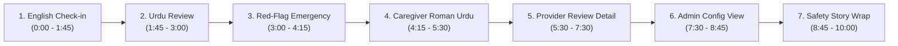

# ChronicCare AI — 17 November Live Demo Cue Sheet

> **Presenter Guide & 10-Minute Script (Release 2 / Week 3)**  
> Strict 10-minute running order across Patient, Provider, and Admin portals.  
> *Target Environment*: Live production site first (`https://chronicare-ai.netlify.app`), with local development server (`http://localhost:3000` / `http://localhost:8000`) as instant hot fallback.  
>
> [!CAUTION]
> **Clinical Safety & Evidence Boundary**:
> - *"Research prototype for proactive chronic condition monitoring. Not a medical device."*
> - *"Doctor review is not clinical validation."*
> - Strictly fake demo accounts only (`patient@demo.care`, `dr.sanamalik@citygeneral.org`, `admin@chronicare.org`).
> - No claims beyond those documented in `docs/REPORT_EVIDENCE.md`.

---

## 1. Release 2 Feature Flag Plan (17 Nov Demo)

The system runs under strictly verified Release 2 flags. If any live cloud dependency fails, the system automatically falls back as designed:

| Flag Name | Demo Setting | Purpose / Fallback Policy | Live Fallback if Failure |
| :--- | :--- | :--- | :--- |
| `INTERVIEW_ENGINE` | `"v2"` | Default clinical interview engine. (v3 held behind flag per `docs/V3_DECISION.md`). | v2 deterministic engine is self-contained. |
| `ORCHESTRATOR` | `"direct"` | Check-in orchestrator (`direct` default; LangGraph `graph` mode proven 100% equivalent across 78/78 cases). | direct execution has zero external dependencies. |
| `EXPLAIN_ENABLED` | `"true"` (or `"false"`) | Asynchronous background explainer. Turned on only if Day 7 smoke passes. | **Instant Fallback**: turning `EXPLAIN_ENABLED=false` routes all check-ins to deterministic templates (`rag/templates.json`). |
| `EXPLAIN_MODE` | `"background"` | Non-blocking /complete API response; LLM explanation processed asynchronously by worker. | If worker is delayed, UI polls up to 90s then cleanly displays templates. |
| `EXPLAIN_LLM_LANGUAGES` | `"en"` | Release 2 setting: LLM explanations generated in English only. Urdu and Roman Urdu check-ins route safely to verified deterministic templates. | Instant automated fallback to templates via `language_template_only` guard. |
| `RISK_ENABLED` | `"true"` | Provider-only cardiometabolic risk panel (#90). | Strictly hidden from patient view (response risk is `null`). |
| `RISK_CAN_RAISE` | `"false"` | Risk model is advisory only; cannot raise patient triage level. | Invariant enforced by `triage_protocol.py`. |
| `DANGER_WORDGROUPS_ENABLED`| `"true"` | Vernacular Urdu composable danger word groups detector. | Raises uncaptured Urdu danger cues to `review`. |
| `OCR_ENABLED` | `"false"` | Server-side prescription RapidOCR spike. Disabled for primary demo. | Manual profile reading entry. |

---

## 2. Cold-Start & Slow LLM Contingency Talking Points

### Cold-Start Server Wakeup (15–40s delay)
- **What happens**: The live cloud API (Render free tier) spins down containers after inactivity. The first HTTP request triggers container wakeup.
- **What to say**:  
  > *"The live backend runs on a managed free-tier container. When idle, container wake-up takes 15 to 40 seconds. Observe that the user interface immediately informs the patient with a calm notification bar: 'Waking up the server, this can take up to a minute on the free test plan'. It clears automatically the moment the backend health check succeeds."*
- **Backup**: If live cloud server takes >45s, toggle browser tab to pre-warmed local deployment (`http://localhost:3000`).

### Slow External LLM / Rate-Limit (Groq 429)
- **What happens**: Groq free tier enforces a strict 1000 output tokens/minute ceiling. If the API hits rate limits or latency spikes, the background worker paces requests or triggers fallback.
- **What to say**:  
  > *"Our explainer architecture prioritizes clinical correctness over raw speed. The patient's triage assessment is calculated deterministically and returns immediately—our median `/complete` API response is under 200 milliseconds. The plain-language explanation generates in the background. If Groq exceeds its 1000 tokens/minute rate limit or times out, the circuit breaker protects the system and falls back immediately to validated clinical templates. Safety and triage decisions never wait for an LLM."*

---

## 3. Ten-Minute Live Demo Cue Sheet

### Scene 1: Patient English Check-in $\rightarrow$ Async Explanation [0:00 – 1:45]
- **Portal & User**: Patient Portal (`patient@demo.care`).
- **Actions**:
  1. Click **"Start Daily Check-In"** in English.
  2. Input stable hypertensive reading: BP $135/85\text{ mmHg}$, no severe symptoms.
  3. Submit check-in $\rightarrow$ Observe immediate HTTP 200 response returning triage level **"Routine"** (or **"Review"** if boundary threshold).
  4. Point to the explanation accordion: **"Why this result?"**.
  5. Note the temporary state badge: **"Preparing explanation..."** transitioning within 1–3 seconds to **"Ready"**.
  6. Expand the explanation: show the two verified sentences citing ISH/WHO hypertension guidelines with reference markers `[S1]`.
- **Key Talking Point**: *"The triage assessment never blocks on AI generation. The safety decision is instant; the plain-language explanation arrives asynchronously."*

### Scene 2: Vernacular Urdu Script Check-in at Review [1:45 – 3:00]
- **Portal & User**: Patient Portal (`patient@demo.care`).
- **Actions**:
  1. Switch language toggle to **"اردو" (Urdu)**.
  2. Start check-in: enter glucose $210\text{ mg/dL}$ with mild fatigue (*"تھکن ہے"*).
  3. Complete interview: the system recognizes elevated blood sugar without acute crisis.
  4. Result screen shows 🟡 **"جائزہ درکار ہے" (Review Needed)**.
  5. Expand Urdu explanation: observe validated Urdu-script guidance rendered with 98.7% Urdu character purity, advising clinical re-check without altering medications.
- **Key Talking Point**: *"Urdu is a first-class language throughout the architecture, not an afterthought machine translation. Questions and guidance adhere to Pakistani clinical phrasing."*

### Scene 3: Red-Flag Danger Phrase $\rightarrow$ Emergency Bypass [3:00 – 4:15]
- **Portal & User**: Patient Portal (`patient@demo.care`).
- **Actions**:
  1. Start a new check-in. In any symptom field, type acute red-flag text: *"severe chest pain radiating to left arm"* (or Urdu: *"سینے میں شدید درد اور بائیں بازو میں درد"*).
  2. Submit answer $\rightarrow$ Observe **immediate interview termination**.
  3. Result displays 🔴 **"EMERGENCY"** red alert banner: *"Call 1122 immediately. Your care team is being notified."*
  4. Point out: **No LLM is invoked**. Explanation accordion is completely absent.
- **Key Talking Point**: *"Under life-threatening red flags, an LLM is never called. The system executes an immediate fail-safe emergency bypass and displays emergency service dispatch instructions."*

### Scene 4: Caregiver Answering in Roman Urdu [4:15 – 5:30]
- **Portal & User**: Patient Portal (`patient@demo.care`).
- **Actions**:
  1. Select Roman Urdu language option.
  2. Check-in as caregiver: *"Main apne walid ki readings darj kar raha hoon"* (proxy reporting).
  3. Input readings: BP $150/95\text{ mmHg}$, report medication adherence as *"subah dawai li thi"* (morning medicine taken).
  4. Complete check-in: system correctly attributes proxy entry (G-14 P0 fix), validates adherence, and routes to appropriate review level.
- **Key Talking Point**: *"In Pakistan, family caregivers frequently enter data for elderly relatives. Our pipeline safely parses Roman Urdu proxy answers and preserves data provenance."*

### Scene 5: Provider Dashboard $\rightarrow$ Review Queue & Risk Panel [5:30 – 7:30]
- **Portal & User**: Provider Portal (`dr.sanamalik@citygeneral.org`).
- **Actions**:
  1. Sign into Provider Dashboard. Observe live clinical queue: emergencies at the top, followed by urgent and review check-ins.
  2. Open the check-in from Scene 1 / Scene 2.
  3. **Audit Trace View**: inspect execution steps (`intake` $\rightarrow$ `build_bundles` $\rightarrow$ `reconcile` $\rightarrow$ `verify` $\rightarrow$ `decide_triage` $\rightarrow$ `risk` $\rightarrow$ `explain`).
  4. **Doctor-Only Risk Panel (#90)**:
     - Point to the cardiometabolic risk panel clearly labelled: **"Experimental / Decision-Support Only — Not for Patient View"**.
     - Point to categorical risk level and clinical contributing factors (age, BP, BMI).
     - Emphasize that raw probability scores are suppressed and patients never receive risk scores.
- **Key Talking Point**: *"Physicians get complete explainability: deterministic execution trace, clinical guideline citations, and an experimental risk panel that is strictly sealed from patient eyes."*

### Scene 6: Admin Portal $\rightarrow$ System Configuration View [7:30 – 8:45]
- **Portal & User**: Admin Portal (`admin@chronicare.org`).
- **Actions**:
  1. Navigate to `/admin` $\rightarrow$ System Configuration View (`/api/admin/config-status`).
  2. Inspect feature flag settings (`INTERVIEW_ENGINE: v2`, `ORCHESTRATOR: direct`, `EXPLAIN_ENABLED`, `RISK_ENABLED`).
  3. Inspect external API credentials status: verify that Groq, Gemini, and Firebase keys display strictly as **`SET`** or **`NOT SET`**.
  4. Emphasize zero credential leakage across endpoints, logs, and frontend bundles.
- **Key Talking Point**: *"System administrators have complete visibility over active feature flags and provider health without exposing cryptographic secrets or API keys."*

### Scene 7: Safety Architecture & Conclusion [8:45 – 10:00]
- **Summary Points**:
  1. **"The Model Proposes, the Rules Decide"**: LLMs and ML classifiers suggest explanations and risk bands; deterministic clinical rules govern all triage escalations.
  2. **Deterministic Fallback**: If LLM infrastructure goes down or rate limits are reached, the system seamlessly falls back to 100% safe, pre-approved clinical templates.
  3. **Verified Traceability**: Every requirement from the proposal is backed by automated regression tests in CI and documented in `docs/TRACEABILITY.md`.
  4. **Closing Disclaimer**: *"ChronicCare AI is a research decision-support prototype. Doctor review is not clinical validation."*

---

## 8. Guideline Licensing & Presentation Compliance Rules (Rule Y2)

To comply with written academic permissions granted on 5 November 2026:
1. **No Verbatim ADA Excerpt Text:** Presenters, authors, and slides must **never** display raw or verbatim excerpt text from ADA guidelines in slides, posters, reports, or papers.
2. **Standard Academic Citations:** In references and bibliography slides, cite ADA Standards of Care normally.
3. **No Promotional Logos:** The ADA logo and branding must **never** be used in slides, UI mockups, posters, or demo visuals.
4. **Demonstration Screenshots:** Screenshots of patient explanations in slides must come exclusively from **hypertension** check-ins (WHO 2021 / ISH 2020) or show only our own synthesized plain-language text.
5. **Release 2 Plan:** Release 2 sets `EXPLAIN_LLM_CONDITIONS=hypertension,diabetes` on Render; ADA material will be permanently purged on 30 June 2027 (`scripts/rag/delete_source.py --licence ada_2026 --yes`).
