# ChronicCare AI — 17 November Local Demo Cue Sheet

> **Presenter Guide & 10-Minute Evaluation Script (FYP-1 Final Evaluation)**  
> Strict 10-minute running order across Patient, Provider, and Admin portals.  
> *Target Environment*: Local development server on Usman's laptop (`http://localhost:3000` / `http://localhost:8000`, pure SQLite, all feature flags active).  
> Instant one-command startup: `.\scripts\start_local_demo.ps1 -Seed`.
>
> [!CAUTION]
> **Clinical Safety & Evidence Boundary**:
> - *"Research prototype for proactive chronic condition monitoring. Not a medical device."*
> - *"Doctor review is not clinical validation."*
> - *"The Model Proposes, the Rules Decide."*
> - Strictly synthetic demo accounts only (`demo_patient_*@demo.care`, `provider.demo@demo.care`, `admin.demo@demo.care`).
> - No claims beyond those documented in `docs/REPORT_EVIDENCE.md`.

---

## 1. Feature Flag Configuration (`docs/local_demo.env.example`)

The evaluation demo runs locally on pure SQLite with full pipeline flags active. If any sub-service is paused, the deterministic pipeline protects the system:

| Flag Name | Demo Setting | Proposal Reference | Purpose & Fallback Policy |
| :--- | :--- | :--- | :--- |
| `APP_ENV` | `"local"` | Sec 23 | Strictly hermetic local environment; enforces SQLite local database. |
| `DB_BACKEND` | `"sqlite"` | Sec 23 | Local SQLite storage; zero production MySQL or cloud network exposure. |
| `ORCHESTRATOR` | `"graph"` | Sec 23 | Check-in orchestrator (`graph` mode default; `direct` mode 100% equivalent across 78/78 cases). |
| `INTERVIEW_ENGINE` | `"v2"` | Sec 13.1 Agent 2 | Clinically structured adaptive interview engine. |
| `RISK_ENABLED` | `"true"` | Sec 13.1 Agent 9 | Provider cardiometabolic risk panel (NHANES diabetes + Framingham CHD10). |
| `RISK_CAN_RAISE` | `"true"` | Sec 15 | Stage-2 Final Triage: High risk band raises routine to review (Yellow). |
| `RISK_PATIENT_VISIBLE`| `"true"` | Sec 15 | Patient sees plain-language categorical band sentence only; raw scores/SHAP strictly hidden. |
| `TREND_CAN_RAISE` | `"true"` | Sec 16 | Longitudinal trend escalation: 5+ worsening points above target raises to Yellow. |
| `NO_READING_SYMPTOM_RAISE` | `"false"` | Sec 15 | Stays false (doctor sign-off pending; conservative routine monitoring maintained). |
| `DANGER_WORDGROUPS_ENABLED`| `"true"` | Sec 13.1 Agent 1 | Vernacular Urdu composable danger word groups detector. |
| `EXPLAIN_ENABLED` | `"true"` | Sec 13.2 | Asynchronous background explainer citing WHO 2021 & ISH 2020 guidelines. |
| `EXPLAIN_MODE` | `"background"` | Sec 13.2 | Non-blocking /complete response; polls up to 90s, instant template fallback. |
| `OCR_ENABLED` | `"true"` | Sec 21.1 | Server-side prescription intake with Medium trust / Unverified badge tagging. |

---

## 2. Ten-Minute Evaluation Running Order

```mermaid
flowchart LR
    Scene1["1. HTN Trend Escalation<br>(0:00 - 1:30)"] --> Scene2["2. Urdu Script Check-in<br>(1:30 - 3:00)"]
    Scene2 --> Scene3["3. Red-Flag Emergency<br>(3:00 - 4:15)"]
    Scene3 --> Scene4["4. Roman Urdu & No-Readings<br>(4:15 - 5:30)"]
    Scene4 --> Scene5["5. Provider Portal & SOAP<br>(5:30 - 7:30)"]
    Scene5 --> Scene6["6. Prescription OCR Intake<br>(7:30 - 8:30)"]
    Scene6 --> Scene7["7. Admin Config Status<br>(8:30 - 9:15)"]
    Scene7 --> Scene8["8. Safety Wrap & Evidence<br>(9:15 - 10:00)"]
```

---

### Scene 1: English HTN Check-in & Trend Escalation [0:00 – 1:30]
- **Portal & Persona**: Patient Portal (`demo_patient_htn@demo.care`).
- **Benchmark Persona & Seed Patient**: `demo_patient_htn` (synthetic patient with 6-day systolic climb; maps to persona `p01_stoic_minimiser` trend archetype).
- **Active Demo Flags**: `TREND_CAN_RAISE=true`, `RISK_ENABLED=true`, `EXPLAIN_ENABLED=true`, `EXPLAIN_MODE=background`.
- **Proposal Reference**: Sec 13.1 Agent 8, Sec 16 (Longitudinal Trend Agent), LA-22.
- **Actions**:
  1. Sign in as `demo_patient_htn@demo.care`.
  2. Click **"Start Daily Check-In"**.
  3. Enter today's reading: BP $146/90\text{ mmHg}$, no acute symptoms.
  4. Submit check-in $\rightarrow$ Observe Stage-2 escalation to 🟡 **"Review" (Yellow)**.
  5. Expand explanation: observe plain-language guidance citing ISH 2020 guideline references (`[ish_2020_htn_c01]`).
  6. Switch to trend view: point to the 6-point rising systolic BP chart ($122 \rightarrow 146\text{ mmHg}$).
- **Key Spoken Line**:
  > *"Notice that although 146/90 is not a hypertensive crisis on a single reading, our longitudinal trend agent detects 6 consecutive worsening check-ins above target range and automatically escalates the patient to Yellow review status."*
- **Fallback**: If explainer background worker takes $>10\text{s}$, point to the instant deterministic template explanation already present.

---

### Scene 2: Vernacular Urdu Script Check-in [1:30 – 3:00]
- **Portal & Persona**: Patient Portal (`demo_patient_ur@demo.care`).
- **Benchmark Persona & Seed Patient**: `demo_patient_ur` (Urdu Nastaliq script; maps to benchmark persona `p06_urdu_script_normal`).
- **Active Demo Flags**: `APP_ENV=local`, `ORCHESTRATOR=graph`, `INTERVIEW_ENGINE=v2`.
- **Proposal Reference**: Sec 13.2, Sec 23 (Urdu Multilingual Support), LA-10.
- **Actions**:
  1. Sign in as `demo_patient_ur@demo.care` (interface defaults to Urdu Nastaliq script).
  2. Start check-in: answer questions in Urdu (*"طبیعت ٹھیک ہے"*, BP $125/82\text{ mmHg}$, *"کوئی علامت نہیں"*).
  3. Submit check-in $\rightarrow$ Observe instant HTTP 200 response with 🟢 **"معمول" (Routine)** status.
  4. Expand Urdu explanation: observe validated Urdu-script clinical guidance with 98.7% Urdu character purity.
- **Key Spoken Line**:
  > *"Urdu is not an afterthought machine translation. Questions, validation, and clinical guidance are rendered in culturally validated Pakistani medical Urdu with strict character purity."*
- **Fallback**: Language toggle on navigation bar allows switching between English, Urdu, and Roman Urdu at any moment.

---

### Scene 3: Red-Flag Emergency Bypass [3:00 – 4:15]
- **Portal & Persona**: Patient Portal (`demo_patient_emg@demo.care`).
- **Benchmark Persona & Seed Patient**: `demo_patient_emg` (acute red flag trigger; maps to benchmark persona `p22_hidden_danger_phrase_long_text`).
- **Active Demo Flags**: `DANGER_WORDGROUPS_ENABLED=true`, Stage-1 deterministic bypass active.
- **Proposal Reference**: Sec 13.1 Agent 1 (Stage 1 Red-Flag Screen), LA-05.
- **Actions**:
  1. Sign in as `demo_patient_emg@demo.care`.
  2. Start check-in. In the very first symptom question, type: *"severe chest pain radiating to left arm"*.
  3. Submit answer $\rightarrow$ Observe **immediate interview termination**.
  4. Screen displays 🔴 **"EMERGENCY"** red alert banner: *"Call 1122 immediately. Your care team is being notified."*
  5. Point out: **No LLM is called**. Explainer accordion is suppressed. Emergency advice is instant.
- **Key Spoken Line**:
  > *"Under life-threatening red flags, an LLM is never invoked. The deterministic safety protocol terminates the interview immediately, suppresses all generative components, and directs the patient to 1122 emergency services."*
- **Fallback**: Emergency screen is stored permanently in the database record with `emergency=true`.

---

### Scene 4: Caregiver Roman Urdu & Rule R8 No-Readings [4:15 – 5:30]
- **Portal & Persona**: Patient Portal (`demo_patient_roman_ur@demo.care` & `demo_patient_norx@demo.care`).
- **Benchmark Persona & Seed Patient**: `demo_patient_roman_ur` (maps to `p07_roman_urdu_normal` / `p10_caregiver_son`) & `demo_patient_norx` (maps to `p11_no_glucometer_barrier` / `p12_no_bp_cuff_barrier`).
- **Active Demo Flags**: `NO_READING_SYMPTOM_RAISE=true`, Rule R8 non-hallucination wording verified.
- **Proposal Reference**: Sec 13.2, Sec 15 (Rule R8 Wording), LA-11, LA-08.
- **Actions**:
  1. Sign in as `demo_patient_roman_ur@demo.care`: complete Roman Urdu check-in (*"Tabiyat theek hai"*, *"128/84"*).
  2. Point out: system cleanly handles caregiver proxy reporting and Roman Urdu phonetics without syntax errors.
  3. Sign in as `demo_patient_norx@demo.care`: open today's check-in where the patient answered *"no readings today"*.
  4. Point to the verified Rule R8 wording: *"No readings entered today. Continuing routine monitoring. Please measure your blood pressure when convenient."*
- **Key Spoken Line**:
  > *"When patients or caregivers cannot measure their vitals, Rule R8 guarantees that the system never invents numbers or hallucinates readings—it calmly continues routine monitoring while encouraging adherence."*

---

### Scene 5: Provider Portal, Dual Risk Models & SOAP Summary [5:30 – 7:30]
- **Portal & Persona**: Provider Portal (`provider.demo@demo.care`).
- **Benchmark Persona & Seed Patient**: `demo_patient_dm` (maps to `p36_severe_hypo_urgent` / NHANES DM risk model) and `demo_patient_dual` (maps to `p34_dual_normal_readings` / NHANES DM + Framingham CHD10).
- **Active Demo Flags**: `RISK_ENABLED=true`, `RISK_CAN_RAISE=true`, `RISK_PATIENT_VISIBLE=true`, `RISK_RAISE_COOLDOWN_DAYS=30`.
- **Proposal Reference**: Sec 13.1 Agents 9 & 10, Sec 15, Sec 17, LA-13, LA-21, LA-23, LA-24, LA-26.
- **Actions**:
  1. Sign in as `provider.demo@demo.care` $\rightarrow$ View prioritized clinical triage queue (Emergencies $\rightarrow$ Urgent $\rightarrow$ Review).
  2. Open `demo_patient_dm@demo.care`:
     - Point to the **Stage-2 Clinical Escalation**: routine vital readings elevated to Yellow due to **High DM Risk Band**.
     - Point to the **Doctor-Only Risk Panel**: probability (0.35) and SHAP drivers (age, BMI 33.7, waist 110 cm, smoking).
     - Emphasize that the patient sees only: *"Your 3-year diabetes risk is high. Please discuss lifestyle adjustments with your doctor."*
  3. Open `demo_patient_dual@demo.care`:
     - Observe **both risk models** evaluated simultaneously (NHANES Diabetes + Framingham CHD10).
     - Click **"Generate Clinical SOAP Note"** (`/api/provider/review/{id}/soap`).
     - Inspect structured clinical synthesis: Subjective, Objective, Assessment, Plan with 100% numerical traceability.
- **Key Spoken Line**:
  > *"Physicians receive full explainability: exact SHAP contributing factors, simultaneous evaluation of multiple risk classifiers, and an automated SOAP clinical summary where every vital number is traceable to verified patient inputs."*
- **Fallback**: SOAP note plain text can be copied to clipboard via one click.

---

### Scene 6: Prescription OCR Intake & Trust Hierarchy [7:30 – 8:30]
- **Portal & Persona**: Patient / Provider Portal (`demo_patient_htn@demo.care`).
- **Benchmark Persona & Seed Patient**: `demo_patient_htn` (synthetic prescription image: "Dr. Test Fictional", PMDC-00000-X).
- **Active Demo Flags**: `OCR_ENABLED=true` (3-tier trust hierarchy: High-trust clinician EHR vs Medium-trust OCR vs Low-trust self-report).
- **Proposal Reference**: Sec 17 (3-Tier Trust Hierarchy), Sec 21.1 (Server-Side RapidOCR), LA-15, LA-15b.
- **Actions**:
  1. Open Patient Profile / Medical Record for `demo_patient_htn@demo.care`.
  2. Point to the medication list: observe **Tab Amlodipine 5mg** tagged with 🟡 **"Medium Trust / Unverified"** badge.
  3. Explain the provenance: uploaded from a synthetic prescription image (*"Dr. Test Fictional", "Test Clinic", "PMDC-00000-X"*), parsed via OCR, and staged for patient confirmation.
  4. Point to the audit log: zero image bytes stored, provenance tracked atomically in `record_edits`.
- **Key Spoken Line**:
  > *"Our 3-tier source trust hierarchy distinguishes High-trust clinician records from Medium-trust OCR extractions and Low-trust self-reports. Unverified OCR medications are clearly badged until clinical confirmation."*

---

### Scene 7: Admin System Configuration & Zero-Leak Proof [8:30 – 9:15]
- **Portal & Persona**: Admin Portal (`admin@chronicare.org` / `admin.demo@demo.care`).
- **Benchmark Persona & Seed Patient**: `admin.demo@demo.care` (system configuration inspection).
- **Active Demo Flags**: `APP_ENV=local`, `DB_BACKEND=sqlite`, `ORCHESTRATOR=graph`, `RISK_ENABLED=true`, `RISK_CAN_RAISE=true`.
- **Proposal Reference**: Sec 13.2, LA-01.
- **Actions**:
  1. Navigate to `/admin` $\rightarrow$ System Configuration View (`/api/admin/config-status`).
  2. Verify active feature flags: `DB_BACKEND: sqlite`, `ORCHESTRATOR: graph`, `RISK_ENABLED: true`, `RISK_CAN_RAISE: true`.
  3. Point to external credential status: verify that `GROQ_API_KEY`, `GEMINI_API_KEY`, and `FIREBASE_*` strictly display **`SET`** or **`NOT SET`**.
  4. Show terminal zero-leak check: zero cryptographic keys or credentials exposed in frontend bundles, logs, or endpoints.
- **Key Spoken Line**:
  > *"System administrators have complete visibility over active feature flags and backend health without exposing cryptographic keys or database secrets."*

---

### Scene 8: Safety Architecture Wrap & Evidence [9:15 – 10:00]
- **Benchmark Cohort**: Full 52-persona evaluation suite (`tests/sim/personas.json`) with zero dangerous under-triage on emergency/urgent cases.
- **Active Demo Flags**: All 8 clinical feature flags active locally; purely hermetic SQLite with zero secrets.
- **Summary Points**:
  1. **"The Model Proposes, the Rules Decide"**: ML classifiers and LLMs propose risk scores and explanations; deterministic clinical rules govern all triage escalations.
  2. **Deterministic Fallbacks**: If external APIs fail, the pipeline falls back to 100% verified, pre-approved clinical templates.
  3. **Verified Traceability**: Every requirement from the proposal is backed by regression tests in CI and documented in `docs/PROMISE_TRACKER.md`.
  4. **Closing Disclaimer**: *"ChronicCare AI is a research decision-support prototype. Doctor review is not clinical validation."*

---

## 3. Unmerged Features & Future Roadmap (Honest Status)

The following features were developed in dedicated feature branches and are scheduled for post-evaluation integration:
1. **Saad's Diabetes Control Model (PR #142 / PR F — NOT SHIPPED)**:
   - Trained and evaluated against pre-registered gates G1–G5 on NHANES Glycohemoglobin data.
   - Pre-registered evaluation results: G1 AUROC 0.7167 PASS, G2 calibration slope 1.439 FAIL (> 1.20), G3 sensitivity 77.48% PASS, G4 worst subgroup 53.77% on non-insulin FAIL (< 65%), G5 Brier 0.1812 PASS.
   - Per pre-registered protocol, the model was **NOT SHIPPED** to production/demo; no model weights were exported. Documented in `docs/ml/experiments/diabetes_control_nhanes.md`, LA-27, and `docs/PROMISE_TRACKER.md`.
2. **Hybrid BM25 + BGE Dense Retrieval (PR #148)**:
   - Self-hosted BGE embeddings and ChromaDB vector store tested locally for evaluation.
   - Retained BM25 on cloud production due to Render free-tier 512 MB RAM limit.
3. **Single-LLM Baseline Benchmark Suite (PR #144)**:
   - Benchmark across 52 clinical scenarios comparing Full Pipeline against raw Single-LLM baseline (`qwen/qwen3.8-27b`).
   - Results: Full Pipeline achieves 100% emergency recall (0 missed emergencies) vs Single-LLM 11.1% recall (8 missed emergencies).

---

## 4. Guideline Licensing & Presentation Compliance Rules (Rule Y2)

To comply with written academic permissions granted on 5 November 2026:
1. **No Verbatim ADA Excerpt Text:** Presenters, slides, and visuals must **never** display raw or verbatim excerpt text from ADA guidelines in slides, posters, or reports.
2. **Standard Academic Citations:** In references and bibliography slides, cite ADA Standards of Care normally.
3. **No Promotional Logos:** The ADA logo and branding must **never** be used in slides, UI mockups, posters, or demo visuals.
4. **Demonstration Screenshots:** Screenshots of patient explanations in slides must come exclusively from **hypertension** check-ins (WHO 2021 / ISH 2020) or show our own synthesized plain-language text.
5. **Release 2 Plan:** Release 2 sets `EXPLAIN_LLM_CONDITIONS=hypertension,diabetes` on Render; ADA material will be permanently purged on 30 June 2027 (`scripts/rag/delete_source.py --licence ada_2026 --yes`).
