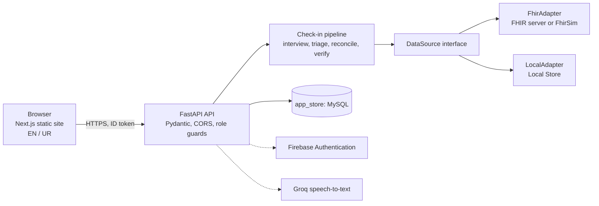

# ChronicCare AI

A patient-centred, AI-assisted chronic disease management platform for Type 2 Diabetes and Hypertension. FAST-NUCES Final Year Project, Fall 2026 (FYP-1, Iteration 1).

[](https://github.com/UsmanBari/chroniccare-ai/actions/workflows/ci.yml)

Research prototype. Not a medical device. It does not diagnose, treat or replace a clinician. No real patient data is used. Every result screen carries a prototype notice. When the system is unsure, the triage level goes up, never down.

## What it does

A patient does a short daily check-in (typed or by voice, English or Urdu). The system asks adaptive questions, applies deterministic, clinician-reviewed triage rules, compares what the patient said with the health record, and sends anything risky to a provider for review.

- **Patient portal**: sign in, choose a record source, complete the check-in, see the triage level and 8-day trends, record allergies and a health profile (with height in cm or ft+in, and weight in lb or kg).
- **Provider portal**: review queue with acknowledge / resolve / escalate and notes.
- **Admin portal**: users, platform figures and audit log.
- **Two record modes**:
  - *Connected*: reads a hospital record through HL7 FHIR R4 (built-in FHIR simulator or the public SMART Health IT test server).
  - *Isolated*: the patient's own record in a Local Store, every row tagged with its origin.
- **Safety by design**: four triage levels (routine, review, urgent, emergency) that can only rise; five triage protocols; emergency answers are saved atomically; "unknown" is never treated as "absent"; glucose units are checked (mmol/L is converted at x 18.0, a bare number asks for the unit).
- **Source-blind reconciliation and verification**: the comparison never decides which value is right; it reports "agrees", "differs" or "no data".
- The AI is used for speech-to-text and optional wording only. Triage levels come from rules, not from a language model.

## Live demo

| Part | Address |
|---|---|
| Web app (Netlify) | https://chronicare-ai.netlify.app |
| API (Render, free tier) | https://chroniccare-backend-w568.onrender.com/api/health |

*The free-tier API sleeps when idle: the first request can take 13 to 60 seconds to wake it.*

## Architecture

Five layers, 36 REST endpoints.



| Layer | Technology |
|---|---|
| Presentation | Next.js 14, React 18, TypeScript, Tailwind, Recharts, three portals, English and Urdu |
| API | FastAPI, Pydantic validation, 36 endpoints, token checks and role guards |
| Application | Hand-coded check-in pipeline with deterministic modules (adaptive interview, triage protocols, reconciliation, verification) |
| Data access | One DataSource interface over FHIR (client or simulator) and the Local Store; app_store for the application database |
| External | Aiven MySQL, Firebase Authentication, a FHIR server, Groq (speech) |

**Deployment**: Netlify (static site) + Render (API) + Aiven MySQL, built and deployed from GitHub Actions. Single points of failure on the free tiers: one Render instance, one MySQL node, Firebase sign-in. The API keeps no state in memory, so it is designed to scale out; this has not been measured with several instances.

## Repository layout

```
chroniccare-ai/
├── app/                              Next.js 14 frontend (components, context, EN/UR translations)
│   ├── components/                   Modular React screens across Patient, Provider, and Admin portals
│   │   ├── admin/                    Admin portal screens (user directory, audit logs, platform figures)
│   │   │   ├── AdminDashboard.tsx    Admin dashboard (users, system figures, audit trail)
│   │   │   └── AdminLoginScreen.tsx  Admin authentication screen
│   │   ├── provider/                 Provider portal screens (triage queue, alerts, notes, scheduling)
│   │   │   ├── ProviderDashboard.tsx Clinical dashboard and real-time review counters
│   │   │   ├── ProviderLoginScreen.tsx Clinician authentication screen
│   │   │   ├── ProviderQueue.tsx     Triage review queue with acknowledge/resolve/escalate actions
│   │   │   ├── ReconciliationAlertDetail.tsx Clinical comparison details, medication reconciliation, notes
│   │   │   └── ScheduleAppointmentModal.tsx Clinician appointment scheduling drawer
│   │   ├── AdaptiveInterviewScreen.tsx Conversational adaptive check-in interview (EN/UR, speech/text)
│   │   ├── CheckInEntryScreen.tsx    Check-in launchpad with recent status and condition reminders
│   │   ├── ConfirmationScreen.tsx    Pre-submission answer and medication adherence confirmation
│   │   ├── ConflictScreen.tsx        Self-reported vs hospital record conflict presentation
│   │   ├── ConnectionScreen.tsx      EHR connection selector (Hospital FHIR vs Isolated Local Store)
│   │   ├── ConsentScreen.tsx         Explicit patient clinical telemetry and data consent screen
│   │   ├── DemoFooter.tsx            Fixed evaluation footer with prototype disclaimer
│   │   ├── EmergencyScreen.tsx       Immediate red-flag emergency guidance and emergency hotline
│   │   ├── ErrorBoundary.tsx         Top-level crash resilience and error recovery boundary
│   │   ├── EvaluatorTourModal.tsx    Guided multi-portal walkthrough tour for evaluators
│   │   ├── Header.tsx                Navigation bar with language toggle, portal switch, settings, logout
│   │   ├── HealthProfileScreen.tsx   Physical profile, conditions, diagnosis years, comorbidities, units (cm/ft+in, lb/kg)
│   │   ├── HealthRecordScreen.tsx    Patient record inspection view with provenance badges
│   │   ├── HomeScreen.tsx            Patient home dashboard with check-in call to action
│   │   ├── InclusionScreen.tsx       Clinical inclusion questionnaire (T2D/HTN, age, pregnancy status)
│   │   ├── LoginScreen.tsx           Patient Firebase email/password authentication screen
│   │   ├── PatientAppointmentsScreen.tsx Patient view of scheduled clinical consultations
│   │   ├── PortalLandingScreen.tsx   Multi-portal selector and evaluator entry screen
│   │   ├── ProcessingScreen.tsx      Atomic submission and pipeline processing animation
│   │   ├── RiskResultScreen.tsx      Post-check-in triage level display and clinical guidance
│   │   ├── RoutedToReviewScreen.tsx  Informational screen when check-in is routed to clinical review
│   │   ├── TrendScreen.tsx           8-day multi-day vital signs and symptom trends (Recharts)
│   │   └── UnifiedSettingsModal.tsx  Slide-over modal for language, connection, and role settings
│   ├── context/                      Client application state management
│   │   └── AppContext.tsx            Central React context (auth, session, profile, translations)
│   ├── lib/                          Frontend utilities and API integration
│   │   ├── api.ts                    Typed API client covering all 36 FastAPI endpoints
│   │   ├── firebase.ts               Firebase authentication initialization and token management
│   │   ├── presentation.ts           Presentation helpers, age calculation from DOB, unit labels
│   │   └── roles.ts                  Role mapping and route-guard enforcement
│   └── translations/                 Bilingual localization engine
│       └── index.ts                  Curated English and Urdu (اردو) translation dictionary
├── tests/                            Frontend test suite (19 Vitest test files in jsdom)
│   ├── auth-session.test.tsx         Session expiry and token handling tests
│   ├── blocked-action.test.ts        Role and state transition permission tests
│   ├── demo-readiness.test.tsx       Demo presentation and layout integrity tests
│   ├── ehr-connection-parity.test.tsx FHIR vs Local Store mode parity tests
│   ├── honest-labels.test.ts         Honest UI disclaimers and label veracity tests
│   ├── hypertension-parity.test.tsx  Hypertension check-in flow and parity tests
│   ├── medication-flow.test.tsx      Medication selection and confirmation tests
│   ├── medication-result.test.ts     Medication triage and warning logic tests
│   ├── new-user-journey.test.tsx     Onboarding from consent to initial profile tests
│   ├── no-fake-values.test.tsx       Verification that unentered fields remain undefined
│   ├── onboarding-conditions.test.tsx Independent condition selection (T2D, HTN, Both) tests
│   ├── pregnancy-eligibility.test.tsx Pregnancy status screening and clinical gating tests
│   ├── presentation.test.ts          Presentation math, date formatting, and age calculation tests
│   ├── profile-units.test.tsx        Height (ft+in/cm) and weight (lb/kg) conversion and toggle tests
│   ├── richer-enrolment.test.ts      Background profile fields and BMI integration tests
│   ├── scroll-behavior.test.tsx      Scroll position and screen navigation accessibility tests
│   ├── ux-logout-eye.test.tsx        Password toggle and logout UX tests
│   ├── voice-checkin-entry.test.tsx  Voice check-in initialization and microphone state tests
│   └── voice-input.test.ts           Speech-to-text integration and transcription fallback tests
├── backend-poc-technical/            FastAPI backend and comprehensive test suite
│   ├── main.py                       FastAPI application, Pydantic request/response schemas, 36 endpoints
│   ├── init_local_db.py              Database initialization script for SQLite/MySQL
│   ├── requirements.txt              Python dependencies (FastAPI, Uvicorn, Pydantic, Pytest, Cryptography)
│   ├── .env.example                  Environment variable template
│   ├── agents/                       Deterministic clinical pipeline modules
│   │   ├── adaptive_interview_agent.py State machine for adaptive interview questions (v2 & v3)
│   │   ├── answer_validation.py      Deterministic range and format validation for check-in answers
│   │   ├── input_triage.py           Free-text and voice phrase classifier (multilingual red-flag screener)
│   │   ├── interview_question_bank.py Curated bank of clinician-approved interview questions
│   │   ├── reconciliation.py         Source-blind comparison of check-in observations vs stored records
│   │   ├── triage_protocol.py        Five clinical triage protocols with monotonic level escalation
│   │   └── verification.py           Rule-based clinical verification and conflict reporting
│   ├── data_sources/                 Abstract data layer and adapters
│   │   ├── data_source.py            Unified DataSource abstract interface
│   │   ├── fhir_adapter.py           HL7® FHIR® R4 adapter (converts FHIR resources to canonical models)
│   │   ├── fhir_client.py            SMART on FHIR HTTP client for external FHIR servers
│   │   ├── fhir_sim.py               In-memory hermetic FHIR server simulator for testing and demo
│   │   ├── local_adapter.py          Local Store adapter for isolated mode
│   │   └── app_store.py              SQLAlchemy/raw SQL persistent store for users, profiles, check-ins
│   ├── auth/                         Authentication and access control
│   │   └── firebase_auth.py          Firebase ID token verification, claim inspection, role guards
│   ├── llm/                          Voice speech-to-text integration
│   │   └── groq_client.py            Groq cloud client for Whisper transcription and optional wording
│   ├── ml/                           Machine learning models (advisory only, Iteration 2)
│   │   ├── baseline_model.py         Baseline risk prediction models
│   │   └── shap_explainer.py         SHAP explanations for clinician review (cannot lower triage levels)
│   └── scenarios/                    Seven end-to-end integration scenario tests
├── scripts/                          Automation, testing, and evidence scripts
│   ├── smoke_test.py                 Live deployment end-to-end smoke test
│   ├── load_test_local.py            Local concurrency load testing script
│   ├── load_test_deployed.py         Remote deployed stack load testing script
│   ├── verify_mutations.py           Mutation proof runner (23 of 23 safety mutation checks)
│   ├── probe_fhir.py                 SMART Health IT live FHIR server probe and verification
│   └── generate_clinician_pack.py    Clinician review evidence pack and question bank generator
├── docs/                             Comprehensive technical, clinical, and architectural documentation
│   ├── ACCESSIBILITY_CHECK.md        WCAG 2.1 AA keyboard navigation, contrast, and screen-reader audit
│   ├── AUTH.md                       Authentication architecture, Firebase configuration, and role guards
│   ├── CLINICAL_RULES.md             Complete specification of deterministic clinical triage protocols
│   ├── CLINICIAN_RESPONSES.md        Clinician review feedback from three practicing physicians
│   ├── DATASETS.md                   Clinical datasets, synthetic cohort specifications, and licensing
│   ├── DATA_DICTIONARY.md            Data dictionary for observations, profiles, and triage records
│   ├── DATA_OWNERSHIP.md             Data governance, consent lifecycle, and patient privacy design
│   ├── DEPLOY.md                     Deployment guide for Netlify, Render, and Aiven MySQL
│   ├── EHR_SANDBOX.md                HL7 FHIR R4 sandbox connectivity, LOINC codes, and conversion factors
│   ├── INTERVIEW_QUESTION_BANK.md    Full text of all interview questions in English and Urdu
│   ├── INTERVIEW_V3_RESEARCH_AND_DESIGN.md Architecture and clinical rationale for v3 interview engine
│   ├── LOAD_TEST_RESULTS.md          Load testing methodology and p95 latency figures
│   ├── MID1_EVIDENCE_PACK.md         Evidence pack for the Mid-1 evaluation milestone
│   ├── SAFETY.md                     Clinical safety invariants (monotonic escalation, atomic persistence)
│   ├── SYSTEM_TEST_RESULTS_Hassaan.md Execution log for system test cases
│   └── ai-usage/                     Transparency log of AI tools used during development
├── .github/workflows/
│   └── ci.yml                        GitHub Actions continuous integration pipeline
├── netlify.toml                      Netlify static site deployment configuration
└── DEMO_SCRIPT.md                    Presenter script with step-by-step demonstration walkthrough
```

## Getting started

Requirements: Node 18 or newer, npm 9 or newer, Python 3.11.

### Backend

```bash
cd backend-poc-technical
python -m venv .venv && source .venv/bin/activate  # Windows: .venv\Scripts\Activate.ps1
pip install -r requirements.txt
cp .env.example .env                              # fill in values; never commit secrets
python init_local_db.py
uvicorn main:app --reload --port 8000
```

Check: `GET http://127.0.0.1:8000/api/health` returns `{"status":"healthy", ...}`.

### Frontend (repository root)

```bash
npm install
npm run dev  # http://localhost:3000
```

Set `NEXT_PUBLIC_API_BASE_URL` (for example in `.env.local`) to the backend address, such as `http://127.0.0.1:8000`. If it is empty, the app has no backend to call. Firebase settings for sign-in are described in `docs/AUTH.md`.

### Environment variables (backend, see `.env.example`)

| Variable | Purpose |
|---|---|
| `APP_ENV` | `production` turns on production guards |
| `CORS_ALLOWED_ORIGINS` | Comma-separated allowed origins, no wildcards |
| `DB_BACKEND`, `LOCAL_DB_PATH`, `MYSQL_URL`, `MYSQL_SSL_CA` | `sqlite` for local and CI, `mysql` in production |
| `FIREBASE_PROJECT_ID`, `DEMO_ROLE_MAP` | Authentication |
| `FHIR_BASE_URL`, `FHIR_PATIENT_ID` | Optional FHIR server override |
| `GROQ_API_KEY`, `GROQ_MODEL`, `GROQ_STT_MODEL` | Speech and optional wording (secret: set only locally or in Render) |
| `REQUIRE_INCLUSION` | Inclusion questions at enrolment |
| `INTERVIEW_ENGINE` | `v2` (default) or `v3` |

## Testing

```bash
# backend (from backend-poc-technical, or use the file list in .github/workflows/ci.yml)
pytest -q

# frontend
npm test      # Vitest
npm run lint
```

Results recorded for the Mid-1 submission (11 October 2026):

| Check | Result |
|---|---|
| Backend suite run by CI | 701 passed |
| Whole backend folder | 744 tests (743 plus one test that needs the network) |
| Frontend | 183 Vitest tests in 18 files (196 tests in 19 files with profile units) |
| Mutation proofs | 23 of 23 detected |
| Live smoke test | 5 of 5 |
| Local load test (one instance) | slowest step p95: 1.9 s at 50 patients, 2.2 s at 100 patients |

*Details: `docs/SYSTEM_TEST_RESULTS_Hassaan.md`, `docs/LOAD_TEST_RESULTS.md`, `docs/MID1_EVIDENCE_PACK.md`.*

## Clinical safety

Triage rules are documented in `docs/CLINICAL_RULES.md` and were reviewed by three clinicians (`docs/CLINICIAN_RESPONSES.md`).

- Open point: the reviewers differ on vomiting (urgent vs emergency). The system currently follows the 13 October decision (urgent). A joint written decision is planned for Iteration 2.
- Safety notes: `docs/SAFETY.md`. Accessibility checks: `docs/ACCESSIBILITY_CHECK.md`.
- Observation comparison uses a 48-hour window; allergies are recorded but not yet compared.

## Documentation index

| Topic | File |
|---|---|
| Deployment and secrets | `docs/DEPLOY.md` |
| Authentication | `docs/AUTH.md` |
| EHR sandbox and FHIR | `docs/EHR_SANDBOX.md` |
| Data dictionary and ownership | `docs/DATA_DICTIONARY.md`, `docs/DATA_OWNERSHIP.md` |
| Datasets | `docs/DATASETS.md` |
| Interview bank and design | `docs/INTERVIEW_QUESTION_BANK.md`, `docs/INTERVIEW_V3_RESEARCH_AND_DESIGN.md` |
| Evidence for the Mid-1 report | `docs/MID1_EVIDENCE_PACK.md` |
| AI tool usage | `docs/ai-usage/` |

## Roadmap

- **Iteration 2**: written clinician confirmation of the rules; guideline-grounded explanations (English and Urdu); two explainable risk models (advisory only, can raise attention but never lower a level); meter and app reading import; trend direction; full-check-in load test on the deployed stack, backups and dependency upgrades; first usability session; MIMIC-III evaluation (access approved).
- **Iteration 3**: daily reminders and appointment requests with provider capacity; model tuning with clinician review and fairness checks.

## Team

FAST National University of Computer and Emerging Sciences, Islamabad.

| Name | Roll no. |
|---|---|
| Usman Bari | 23i-0680 |
| Hassaan Mudassar | 23i-0536 |
| Muhammad Saad | 23i-0077 |

Supervisors: Dr. Basharat Hussain and Ms. Zill-e-Huma.

## Licence and use

Academic project for research and demonstration only. Not approved for clinical diagnostic or commercial use.
