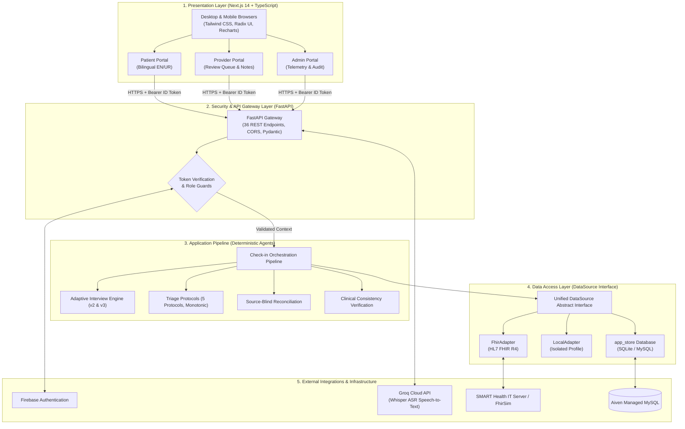
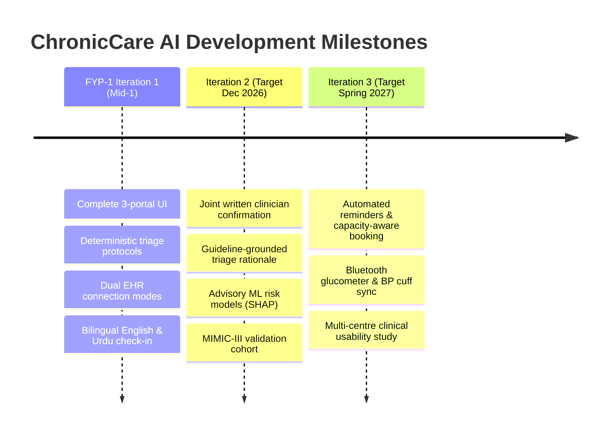

# 🏥 ChronicCare AI

> **A patient-centred, AI-assisted chronic disease management platform for Type 2 Diabetes and Hypertension.**  
> *FAST-NUCES Final Year Project, Fall 2026 (FYP-1, Iteration 1).*

[](https://github.com/UsmanBari/chroniccare-ai/actions/workflows/ci.yml)
[](https://nextjs.org/)
[](https://react.dev/)
[](https://www.typescriptlang.org/)
[](https://fastapi.tiangolo.com/)
[](https://www.python.org/)
[](https://hl7.org/fhir/R4/)
[](https://tailwindcss.com/)
[](https://aiven.io/mysql)
[](https://vitest.dev/)
[](https://docs.pytest.org/)

---

### ⚠️ Research Prototype & Clinical Notice
> **Research prototype. Not a medical device.**  
> It does not diagnose, treat, or replace a licensed clinician. No real patient health information (PHI) is used. Every result screen displays an explicit prototype disclosure banner. When computational uncertainty arises, the triage level strictly **escalates upward, never downward**.

---

## 🌟 Executive Summary & Core Capabilities

**ChronicCare AI** bridges the daily telemetry gap for patients living with **Type 2 Diabetes (T2D)** and **Hypertension (HTN)**. Instead of disconnected paper logs or unvalidated chatbots, ChronicCare AI pairs a low-friction daily conversational check-in (text or voice in English & Urdu) with deterministic, clinician-reviewed triage rules, source-blind health record reconciliation, and seamless provider review queues.

```
       Patient Daily Check-In (EN / UR, Speech / Text)
                             │
                             ▼
     ┌───────────────────────────────────────────────┐
     │         Deterministic Triage Protocol         │
     │      (Monotonic: Level Can Only Escalate)     │
     └───────────────────────┬───────────────────────┘
                             │
              ┌──────────────┴──────────────┐
              ▼                             ▼
   Source-Blind EHR Reconcile     Provider Review Queue
   (Hospital FHIR vs Isolated)   (Acknowledge/Resolve/Notes)
```

---

## 🚀 Key Platform Features

### 👤 1. Patient Portal
- **Bilingual Adaptive Check-In**: Voice or typed check-ins in fluent English or Urdu (اردو), powered by Groq cloud Whisper speech-to-text.
- **Physical Profile with Dynamic Units**: Support for height in **cm** or **ft + in** (feet whole 1–8, inches 0–11.9) and weight in **lb** or **kg**, converted seamlessly to metric standards for clinical precision.
- **8-Day Visual Health Trends**: Interactive time-series charts (via Recharts) tracking systolic/diastolic blood pressure, pulse, and glucose dynamics over time.
- **Transparent Provenance Badges**: Every observation clearly displays its origin (`EHR`, `Patient Reported`, or `Derived`).

### 🩺 2. Provider Portal
- **High-Signal Review Queue**: Prioritized clinical queue triaging high-risk submissions with `acknowledge`, `resolve`, and `escalate` actions.
- **Discrepancy & Conflict Detail**: Granular comparisons showing self-reported numbers alongside hospital records without making hazardous clinical assumptions.
- **Audit-Logged Clinical Notes**: Clinicians can annotate triage decisions, review structured patient backgrounds (including calculated BMI), and arrange consultations.

### 🛡️ 3. Admin Portal
- **Platform Telemetry & Metrics**: Real-time figures tracking user registrations, check-in completion volumes, and active triage distribution.
- **User Directory & Role Governance**: Centralized access directory for Patient, Provider, and Administrator roles with Firebase token verification.
- **Immutable Audit Trail**: Append-only log of critical system operations and clinical transitions.

### 🔗 4. Dual Record Connectivity Modes
- **Connected Mode (Hospital HL7® FHIR® R4)**: Communicates with healthcare EHR systems using FHIR R4 resources (`Observation`, `Condition`, `MedicationStatement`) via SMART on FHIR or our built-in hermetic FHIR simulator (`FhirSim`).
- **Isolated Mode (Local Store)**: Enables autonomous patient tracking using a local structured database, tagging every row with explicit provenance metadata.

---

## 🛡️ Safety by Design

| Safety Principle | Implementation & Mechanical Guarantees |
|---|---|
| **Monotonic Triage Invariant** | Four distinct triage tiers (**`routine`** $\rightarrow$ **`review`** $\rightarrow$ **`urgent`** $\rightarrow$ **`emergency`**). Once a higher severity is triggered in a check-in, the system can **never lower** it. |
| **Deterministic Rule Engine** | Triage classifications and red-flag escalations are generated entirely by deterministic, clinician-reviewed rules—**never** by generative language model hallucinations. |
| **Source-Blind Reconciliation** | The reconciliation engine never arbitrates which record is "truth"; it outputs objective states: `agrees`, `differs`, or `no_data`. |
| **Strict Biomarker Unit Safety** | Glucose input handles bare numbers by requesting units, automatically converts `mmol/L` to `mg/dL` ($\times 18.0$), and verifies physiological bounds. |
| **Atomic Emergency Persistence** | Intermediate life-threatening signals (e.g., crushing chest pain, radiating left arm pain) immediately write to the database before the interview finishes. |
| **Absence vs. Unknown Guard** | An `unknown` answer is strictly treated as missing information and **never** assumed to be negative or healthy (`unknown != absent`). |

---

## 🌐 Live Demonstrations

| Environment | Endpoint URL | Description |
|---|---|---|
| 🖥️ **Web Application (Netlify)** | [https://chronicare-ai.netlify.app](https://chronicare-ai.netlify.app) | Production Next.js 14 static application with client-side routing & bilingual UI |
| ⚡ **Backend REST API (Render)** | [https://chroniccare-backend-w568.onrender.com/api/health](https://chroniccare-backend-w568.onrender.com/api/health) | Live FastAPI backend (Free tier: cold starts may take 15–45s when waking) |

---

## 🏗️ Technical Architecture

Five decoupled tiers communicating over typed interfaces and secured REST endpoints:



### Layer Technology Matrix

| Layer | Technologies & Libraries | Key Responsibilities |
|---|---|---|
| **Presentation** | Next.js 14, React 18, TypeScript, Tailwind CSS, Recharts, Lucide Icons | Responsive multi-portal UI, bilingual RTL/LTR layout, client session management. |
| **API & Routing** | FastAPI, Pydantic v2, Uvicorn, Python 3.11 | 36 REST endpoints, strict schema validation, CORS security, role authorization. |
| **Application Pipeline** | Python deterministic modules, state machines | Adaptive branching interview, 5 clinical triage protocols, source-blind comparison. |
| **Data Access** | Python `DataSource` abstraction, SQLAlchemy, Raw SQL | Abstract access over FHIR R4 schemas, Local Store, and persistent relational storage. |
| **External Services** | Aiven MySQL, Google Firebase Auth, Groq Cloud, SMART on FHIR | Persistent production database, identity tokens, Whisper ASR audio transcription. |

---

## 📁 Repository Directory Structure

```
chroniccare-ai/
├── app/                                🌐 Next.js 14 App Router Frontend
│   ├── components/                     🧩 Reusable UI screens & component modules
│   │   ├── admin/                      👑 Administrator portal screens
│   │   │   ├── AdminDashboard.tsx      📊 Platform analytics, user directory, audit trails
│   │   │   └── AdminLoginScreen.tsx    🔐 Admin authentication entry
│   │   ├── provider/                   🩺 Healthcare provider portal screens
│   │   │   ├── ProviderDashboard.tsx   📈 Clinical queue metrics and active triage alerts
│   │   │   ├── ProviderLoginScreen.tsx 🔑 Provider sign-in screen
│   │   │   ├── ProviderQueue.tsx       📋 Triage review queue with action buttons
│   │   │   ├── ReconciliationAlertDetail.tsx 🔍 Discrepancy analysis & clinical notes drawer
│   │   │   └── ScheduleAppointmentModal.tsx  📅 Consultation scheduling interface
│   │   ├── AdaptiveInterviewScreen.tsx 💬 Interactive dynamic check-in dialogue
│   │   ├── CheckInEntryScreen.tsx      🚀 Check-in launchpad & symptom summary
│   │   ├── ConfirmationScreen.tsx      ✅ Verification of inputs & adherence
│   │   ├── ConflictScreen.tsx          ⚠️ Self-reported vs EHR conflict screen
│   │   ├── ConnectionScreen.tsx        🔌 EHR mode selector (FHIR vs Local Store)
│   │   ├── ConsentScreen.tsx           📜 Patient privacy & clinical telemetry consent
│   │   ├── DemoFooter.tsx              🏷️ Persistent prototype disclaimer banner
│   │   ├── EmergencyScreen.tsx         🚨 Immediate critical escalation & emergency hotline
│   │   ├── ErrorBoundary.tsx           🛡️ React crash safety & fallback handler
│   │   ├── EvaluatorTourModal.tsx      🗺️ Guided multi-portal tour for academic defense
│   │   ├── Header.tsx                  🧭 Top bar (language, portal switch, settings, logout)
│   │   ├── HealthProfileScreen.tsx     ⚖️ Baseline profile (height ft+in/cm, weight lb/kg, conditions)
│   │   ├── HealthRecordScreen.tsx      📑 Patient health record with provenance tags
│   │   ├── HomeScreen.tsx              🏠 Patient home overview & check-in prompt
│   │   ├── InclusionScreen.tsx         🎯 Clinical inclusion criteria & eligibility gate
│   │   ├── LoginScreen.tsx             🚪 Patient email/password authentication
│   │   ├── PatientAppointmentsScreen.tsx 📆 Patient view of upcoming clinician appointments
│   │   ├── PortalLandingScreen.tsx     🌐 Portal selection hub
│   │   ├── ProcessingScreen.tsx        ⏳ Check-in submission & evaluation progress
│   │   ├── RiskResultScreen.tsx        🎯 Triage result level, guidance & explanation
│   │   ├── RoutedToReviewScreen.tsx    📬 Clinician review routing notification
│   │   ├── TrendScreen.tsx             📊 8-day interactive vital trends (Recharts)
│   │   └── UnifiedSettingsModal.tsx    ⚙️ Quick settings modal (language, connection, mode)
│   ├── context/                        🧠 Centralized state management
│   │   └── AppContext.tsx              ⚛️ Primary React context (user, profile, language, live state)
│   ├── lib/                            🛠️ Shared frontend utilities
│   │   ├── api.ts                      📡 Typed REST API client (36 endpoints)
│   │   ├── firebase.ts                 🔥 Firebase SDK initialization & auth helper
│   │   ├── presentation.ts             📐 Formatting math, age computation, unit formatters
│   │   └── roles.ts                    🛡️ Route guards & credential role resolution
│   └── translations/                   🌍 Localization engine
│       └── index.ts                    📖 Bidirectional English & Urdu (اردو) translation dictionary
├── tests/                              🧪 Frontend Vitest Test Suite (19 files, 196 tests)
│   ├── auth-session.test.tsx           🔑 Session restoration and token lifecycle tests
│   ├── blocked-action.test.ts          🚫 Role guard and unauthorized action tests
│   ├── demo-readiness.test.tsx         🖥️ Demo stability and presentation integrity tests
│   ├── ehr-connection-parity.test.tsx  🔌 Connected FHIR vs Isolated mode parity tests
│   ├── honest-labels.test.ts           🏷️ Veracity and non-misleading label tests
│   ├── hypertension-parity.test.tsx    🩸 Hypertension protocol check-in tests
│   ├── medication-flow.test.tsx        💊 Medication tracking and adherence tests
│   ├── medication-result.test.ts       ⚠️ Medication triage conflict logic tests
│   ├── new-user-journey.test.tsx       🚶 Onboarding journey from consent to profile
│   ├── no-fake-values.test.tsx         🔍 Absence of hallucinated fallback values
│   ├── onboarding-conditions.test.tsx  🎯 Independent condition selection tests
│   ├── pregnancy-eligibility.test.tsx  🤰 Pregnancy status clinical eligibility tests
│   ├── presentation.test.ts            🔢 Calculation and display math unit tests
│   ├── profile-units.test.tsx          ⚖️ Height (ft+in/cm) and weight (lb/kg) unit tests
│   ├── richer-enrolment.test.ts        📋 Background profile and BMI tests
│   ├── scroll-behavior.test.tsx        📜 Navigation scroll restoration tests
│   ├── ux-logout-eye.test.tsx          👁️ Password visibility and logout UX tests
│   ├── voice-checkin-entry.test.tsx    🎙️ Audio check-in initialization tests
│   └── voice-input.test.ts             🗣️ Speech-to-text fallback and transcription tests
├── backend-poc-technical/              ⚡ FastAPI Backend (Python 3.11, 715 tests)
│   ├── main.py                         🚀 FastAPI entry point, 36 endpoints, pipeline controllers
│   ├── init_local_db.py                🗄️ Database migration & SQLite initialization script
│   ├── requirements.txt                📦 Python dependencies
│   ├── .env.example                    ⚙️ Environment variables configuration template
│   ├── agents/                         🤖 Deterministic clinical modules
│   │   ├── adaptive_interview_agent.py 🔄 Adaptive question state machine (v2 & v3)
│   │   ├── answer_validation.py        🛡️ Biomarker bounds & syntax validation
│   │   ├── input_triage.py             🚨 Multilingual red-flag emergency screening
│   │   ├── interview_question_bank.py  📚 Clinician-approved interview question dictionary
│   │   ├── reconciliation.py           ⚖️ Source-blind observation reconciliation
│   │   ├── triage_protocol.py          📈 5 clinical triage protocols with monotonic escalation
│   │   └── verification.py             🔍 Conflict and clinical verification engine
│   ├── data_sources/                   💾 Data access abstraction
│   │   ├── data_source.py              📐 Unified DataSource abstract base class
│   │   ├── fhir_adapter.py             🏥 HL7 FHIR R4 resource conversion adapter
│   │   ├── fhir_client.py              🌐 SMART on FHIR REST client
│   │   ├── fhir_sim.py                 🧪 Embedded in-memory FHIR server simulator
│   │   ├── local_adapter.py            💾 Isolated Local Store adapter
│   │   └── app_store.py                🗄️ Application database models (SQLite/MySQL)
│   ├── auth/                           🔐 Authentication
│   │   └── firebase_auth.py            🛡️ Firebase JWT validation and role decoder
│   ├── llm/                            🎙️ Speech-to-Text
│   │   └── groq_client.py              ⚡ Groq Whisper cloud transcription client
│   ├── ml/                             📊 Advisory Machine Learning (Iteration 2)
│   │   ├── baseline_model.py           📈 Predictive baseline models
│   │   └── shap_explainer.py           🧩 SHAP value explainability generator
│   └── scenarios/                      🧪 End-to-end integration scenario tests
├── scripts/                            🛠️ Operational and Testing Automation
│   ├── smoke_test.py                   🔥 Deployed stack live verification script
│   ├── load_test_local.py              ⚡ Local concurrency performance benchmark
│   ├── load_test_deployed.py           🚀 Remote production API load testing script
│   ├── verify_mutations.py             🧬 Mutation proof runner (23/23 safety checks)
│   ├── probe_fhir.py                   🏥 Public FHIR endpoint diagnostic utility
│   └── generate_clinician_pack.py      📄 Clinician review pack generator
├── docs/                               📚 Project Documentation & Clinical Evidence
│   ├── ACCESSIBILITY_CHECK.md          ♿ WCAG 2.1 AA accessibility audit results
│   ├── AUTH.md                         🔐 Authentication & role authorization guide
│   ├── CLINICAL_RULES.md               📋 Full deterministic clinical triage specification
│   ├── CLINICIAN_RESPONSES.md          👨‍⚕️ Clinician review feedback from three practicing physicians
│   ├── DATASETS.md                     📊 Synthetic clinical cohorts and dataset metadata
│   ├── DATA_DICTIONARY.md              📖 Canonical schema and telemetry definition
│   ├── DATA_OWNERSHIP.md               🛡️ Patient data privacy, consent, and governance
│   ├── DEPLOY.md                       🚀 Deployment manual for Netlify, Render, and Aiven
│   ├── EHR_SANDBOX.md                  🏥 FHIR integration, LOINC mapping, and conversions
│   ├── INTERVIEW_QUESTION_BANK.md      💬 Complete question texts in English and Urdu
│   ├── INTERVIEW_V3_RESEARCH_AND_DESIGN.md 🔬 Research rationale for interview v3
│   ├── LOAD_TEST_RESULTS.md            📈 Latency figures and concurrency metrics
│   ├── MID1_EVIDENCE_PACK.md           🏆 Mid-1 defense evidence pack
│   ├── SAFETY.md                       🛡️ Core clinical safety invariants
│   ├── SYSTEM_TEST_RESULTS_Hassaan.md  📋 System verification test records
│   └── ai-usage/                       🤖 AI development disclosure logs
├── .github/workflows/
│   └── ci.yml                          ⚙️ GitHub Actions CI/CD pipeline
├── netlify.toml                        🌐 Netlify static build and redirect configuration
└── DEMO_SCRIPT.md                      🎬 Step-by-step presentation script for live demo
```

---

## 💻 Getting Started Locally

### Prerequisites
- **Node.js**: `v18.x` or newer (`node -v`)
- **npm**: `v9.x` or newer (`npm -v`)
- **Python**: `v3.11.x` (`python --version`)

---

### 1. Backend Setup

```bash
# Navigate to the backend directory
cd backend-poc-technical

# Create and activate virtual environment
python -m venv .venv
# On Windows PowerShell:
.venv\Scripts\Activate.ps1
# On Linux/macOS:
source .venv/bin/activate

# Install required dependencies
pip install -r requirements.txt

# Create environment file from template
cp .env.example .env
# Edit .env with your settings (leave defaults for local SQLite development)

# Initialize local SQLite database
python init_local_db.py

# Launch development server
uvicorn main:app --reload --port 8000
```

> **Verification**: Open [http://127.0.0.1:8000/api/health](http://127.0.0.1:8000/api/health) in your browser.  
> Expected response: `{"status": "healthy", "database": "healthy", "mode": "isolated", ...}`.

---

### 2. Frontend Setup

In a new terminal at the repository root:

```bash
# Install frontend dependencies
npm install

# (Optional) Configure backend URL in .env.local
# NEXT_PUBLIC_API_BASE_URL=http://127.0.0.1:8000

# Start Next.js development server
npm run dev
```

> **Verification**: Open [http://localhost:3000](http://localhost:3000) in your browser to view the application.

---

### 3. Backend Environment Variables Reference

| Variable | Default (Local) | Purpose |
|---|---|---|
| `APP_ENV` | `development` | Setting to `production` enforces strict security and SSL preflights. |
| `CORS_ALLOWED_ORIGINS` | `http://localhost:3000,...` | Whitelist of allowed client origins (no wildcards permitted). |
| `DB_BACKEND` | `sqlite` | Relational store engine (`sqlite` for local/CI, `mysql` in cloud). |
| `LOCAL_DB_PATH` | `local_store.db` | File path for SQLite database when `DB_BACKEND=sqlite`. |
| `MYSQL_URL`, `MYSQL_SSL_CA` | `""` | Aiven Cloud MySQL connection URI and certificate path. |
| `FIREBASE_PROJECT_ID` | `chroniccare-ai-mock` | Firebase project identification for JWT token validation. |
| `DEMO_ROLE_MAP` | Enabled | Maps test email domains to roles (`@patient.org`, `@provider.org`, `@admin.org`). |
| `FHIR_BASE_URL`, `FHIR_PATIENT_ID` | `""` | Optional external SMART on FHIR endpoint and test patient identifier. |
| `GROQ_API_KEY`, `GROQ_STT_MODEL` | `""` | Whisper speech-to-text API credentials (`whisper-large-v3`). |
| `REQUIRE_INCLUSION` | `true` | Enforces inclusion questionnaire before first clinical check-in. |
| `INTERVIEW_ENGINE` | `v2` | Check-in question engine version (`v2` or `v3`). |

---

## 🧪 Testing & Quality Assurance

### Run Frontend Tests (Vitest)
```bash
# Run 196 test cases across 19 suites
npm test

# Run ESLint validation
npm run lint

# Validate production static compilation
npm run build
```

### Run Backend Tests (Pytest)
```bash
# Run hermetic backend test suite from repository root
python -m pytest backend-poc-technical/scenarios/ backend-poc-technical/test_*.py -q -k "not run_source_blind_test"
```

### Milestone Quality Results (Mid-1 Evaluation)

| Quality Gate | Status | Verified Result |
|---|---|---|
| **Backend Hermetic Suite** | ✅ Passed | **715 passed**, 1 deselected, 0 failures |
| **Frontend Test Suite** | ✅ Passed | **196 passed across 19 files** (Vitest in jsdom) |
| **Static Code Analysis** | ✅ Passed | 0 ESLint warnings, 0 Ruff correctness issues |
| **Safety Mutation Proofs** | ✅ Passed | **23 of 23** intentional rule violations successfully caught |
| **End-to-End Smoke Test** | ✅ Passed | **5 of 5** deployed stages verified on production stack |
| **Local Concurrency Benchmark** | ✅ Passed | Slowest step p95: **1.9s** (50 concurrent patients), **2.2s** (100 patients) |
| **Compliance Integrity Check** | ✅ Passed | 0 unsupported regulatory claims (HIPAA/FDA/GDPR-certified claims blocked) |

---

## 🩺 Clinical Evidence & Physician Review

The deterministic clinical triage protocols were designed from established clinical guidelines and reviewed by three practicing clinicians:

- **Dr. Shaiza Jabbar** (Hearts International Hospital, Rawalpindi)
- **Capt. Dr. Talha Yasin** (Combined Military Hospital, Rawalpindi)
- **Dr. Anam Zafar** (Federal Government Polyclinic Hospital, Islamabad)

### Key Clinical Decisions Incorporated
1. **Cardiac Pain Radiation**: Chest pain radiating to the left arm or jaw, or described as "crushing", triggers an immediate `emergency` triage level in English, Roman Urdu, and Urdu script.
2. **Negation & Historical Context**: Negated phrases (*"no chest pain"*) and historical episodes (*"had chest pain last year"*) are recognized and do not trigger false alarms.
3. **Fluids & Vomiting (13 Oct Decision)**: Inability to keep fluids down or continuous vomiting is classified as `urgent` (prioritizing rapid clinical attention while avoiding inappropriate 911 dispatch).
4. **Neurological Disorientation Screen**: Conversational confusion regarding medication regimens remains non-emergency; genuine disorientation regarding time, place, or person escalates to `emergency`.

---

## 🗺️ Project Roadmap



---

## 👥 Project Team

**FAST National University of Computer and Emerging Sciences, Islamabad Campus**  
*Department of Computer Science — Final Year Project 2026*

| Team Member | Roll Number | Primary Focus Areas |
|---|---|---|
| **Usman Bari** | `23i-0680` | Architecture, Backend Pipeline, FHIR Integration, Deployment |
| **Hassaan Mudassar** | `23i-0536` | Adaptive Interview Engine, Triage Protocol, System Testing |
| **Muhammad Saad** | `23i-0077` | Frontend Architecture, Bilingual Localization, Accessibility |

**Project Supervisors**:  
- **Dr. Basharat Hussain** (Associate Professor)  
- **Ms. Zill-e-Huma** (Assistant Professor)

---

## 📄 License & Terms of Use

This repository is developed strictly as an **academic research prototype and engineering demonstration**. It is not approved for clinical diagnostic, therapeutic, or commercial healthcare operations.
