# ChronicCare AI Architecture & System Topology

> **System Motto**: *"The model proposes, the rules decide."*  
> **Status**: Verified Against Repository Code (5 November 2026)  
> **Deployment Context**: Research prototype for adults with type 2 diabetes and hypertension. Decision support only; never diagnoses, never prescribes, never lowers a triage level.

---

## 1. End-to-End Check-In Lifecycle Architecture

The following diagram illustrates the complete execution path of a patient check-in from user intake through triage determination, risk calculation, background clinical explanation, database persistence, and provider review queue escalation.

```mermaid
flowchart TD
    subgraph S_Intake["1. Intake & Adaptive Interview"]
        UI["Patient Portal Web Client\n(Next.js 14 Static Export)"]
        Voice["Voice Dictation\n(POST /api/voice/transcribe)"]
        UI -->|"Audio Blob"| Voice
        UI -->|"Text Response"| EngineRouter{"INTERVIEW_ENGINE\n(default: v2)"}
        
        V2Engine["v2 Rule-Based Engine\n(agents/adaptive_interview_agent.py)"]
        V3Engine["v3 Dynamic Question Planner\n(agents/interview_v3_runner.py)"]
        
        EngineRouter -->|"v2 (default)"| V2Engine
        EngineRouter -->|"v3 (flagged)"| V3Engine
        
        DangerScreen["Stage 1 Danger Screen\n(agents/input_triage.py)"]
        WordGroups{"DANGER_WORDGROUPS_ENABLED\n(default: false)"}
        WGActive["Word Groups Detector v1.1\n(agents/danger_wordgroups.py)"]
        
        V2Engine --> DangerScreen
        V3Engine --> DangerScreen
        DangerScreen --> WordGroups
        WordGroups -->|"true"| WGActive
        WordGroups -->|"false"| CleanInput["Validated Intake State"]
        WGActive --> CleanInput
    end

    subgraph S_Orchestrator["2. Check-In Completion Orchestrator (POST /api/checkins/{id}/complete)"]
        CleanInput --> OrchRouter{"ORCHESTRATOR\n(default: direct)"}
        
        DirectOrch["Direct In-Process Pipeline\n(main.py / orchestrator/steps.py)"]
        GraphOrch["LangGraph StateGraph Pipeline\n(orchestrator/graph.py)"]
        
        OrchRouter -->|"direct"| DirectOrch
        OrchRouter -->|"graph"| GraphOrch
        
        subgraph PipelineSteps["Orchestrator Sequential Nodes"]
            N1["node: intake"]
            N2["node: fetch_prior"]
            N3["node: build_bundles"]
            N4["node: reconcile"]
            N5["node: verify"]
            N6["node: persist_local"]
            N7["node: decide_triage"]
            N8["node: risk"]
            N9["node: explain"]
            N10["node: persist"]
            
            N1 --> N2 --> N3 --> N4 --> N5 --> N6 --> N7 --> N8 --> N9 --> N10
        end
        
        DirectOrch -.-> PipelineSteps
        GraphOrch -.-> PipelineSteps
    end

    subgraph S_Triage["3. Deterministic Decision & Risk Layer"]
        N7 --> RulesDecide["Clinical Protocol Rules\n(agents/triage_protocol.py)\nLevel: routine | review | urgent | emergency"]
        RulesDecide --> TriageResult["Triage Level Decided"]
        
        TriageResult --> RiskGate{"RISK_ENABLED\n(default: false)"}
        RiskGate -->|"false"| RiskNull["Risk: null"]
        RiskGate -->|"true"| RiskCalc["Framingham / UKPDS Risk Score\n(agents/risk_rules.py)"]
        RiskCalc --> RiskCanRaise{"RISK_CAN_RAISE\n(default: false)"}
        RiskCanRaise -->|"true (routine -> review only)"| ElevatedTriage["Triage Level Elevated"]
        RiskCanRaise -->|"false"| StoredRisk["Provider-Only Risk Panel\n(Patients NEVER see risk score/band)"]
        RiskNull --> StoredRisk
        ElevatedTriage --> StoredRisk
    end

    subgraph S_Explain["4. Resilient Explainer Layer"]
        N9 --> ExplainGate{"EXPLAIN_ENABLED\n(default: false)"}
        ExplainGate -->|"false"| ExplTemplate["Deterministic Template Fallback\n(rag/explainer.py)"]
        
        ExplainGate -->|"true"| ModeRouter{"EXPLAIN_MODE\n(default: background)"}
        ModeRouter -->|"inline"| InlineGuard["Guarded Explain (Hard 3s Budget)\n(rag/explain_guards.py)"]
        ModeRouter -->|"background"| JobQueue["FIFO Bounded Job Queue\n(rag/explain_jobs.py, max 50)"]
        
        JobQueue -->|"Immediate Return"| PendingResp["/complete Returns Pending\n(mode: pending, latency < 0.25s)"]
        
        JobQueue -->|"Worker Thread"| DaemonWorker["Daemon Worker Loop\n(guarded_explain background)"]
        
        subgraph GuardedExplainPipeline["Guarded Explain Execution"]
            Pacer["Groq OTPM Pacer\n(1000 output tokens/min window)"]
            H1Cond["Condition Gate (H1)\n(Hypertension only; Diabetes = template)"]
            Cache["LRU Explainer Cache\n(rag/explain_guards.py)"]
            Breaker["Circuit Breakers\n(Groq / Gemini)"]
            Retriever["BM25 Guideline Retriever\n(ada_2026 restricted from Gemini)"]
            ProviderLoop["Provider Router: auto | groq | gemini\n(with exponential backoff on 429)"]
            Validators["Clinical Output Validators\n(Level consistency, citations, grounding)"]
            
            DaemonWorker --> Pacer --> H1Cond --> Cache --> Breaker --> Retriever --> ProviderLoop --> Validators
            InlineGuard --> Pacer
        end
        
        Validators -->|"Passed"| StoredReady["Stored Status: ready\n(mode: llm | cache)"]
        Validators -->|"Failed / Budget Hit"| GuardTemplate["Stored Status: ready\n(mode: template, safe fallback)"]
    end

    subgraph S_Persistence["5. Persistence & Polling"]
        N10 --> StoreWrite["Database Commit\n(create_checkin_result)\ncheckin_results table"]
        StoredRisk --> StoreWrite
        PendingResp --> StoreWrite
        StoredReady --> StoreWrite
        GuardTemplate --> StoreWrite
        
        UI -->|"GET /api/checkins/{id}/explanation\n(Polls up to 90s)"| PollEndpoint["Explanation Endpoint\n(/api/checkins/{id}/explanation)"]
        StoreWrite -.-> PollEndpoint
        PollEndpoint -->|"ready"| UIExplanation["Patient Explanation Card\n(Translated, no mode/reason leakage)"]
    end

    subgraph S_Provider["6. Clinician Oversight"]
        StoreWrite --> ProviderQueue["Provider Review Queue\n(GET /api/provider/review-queue)"]
        ProviderQueue --> ProviderDetail["Checkin Review Detail\n- Audit Trace (node timings)\n- Clinical Explanation (mode, reason, provider)\n- Doctor-Only Risk Panel (#90)"]
    end
```



### Verified Graph Node Definitions
The orchestrator graph nodes correspond directly to the compiled LangGraph `StateGraph` definition in `backend-poc-technical/orchestrator/graph.py`:

```text
backend-poc-technical\orchestrator\graph.py:407:    builder.add_node("intake", node_intake)
backend-poc-technical\orchestrator\graph.py:408:    builder.add_node("fetch_prior", node_fetch_prior)
backend-poc-technical\orchestrator\graph.py:409:    builder.add_node("build_bundles", node_build_bundles)
backend-poc-technical\orchestrator\graph.py:410:    builder.add_node("reconcile", node_reconcile)
backend-poc-technical\orchestrator\graph.py:411:    builder.add_node("verify", node_verify)
backend-poc-technical\orchestrator\graph.py:412:    builder.add_node("persist_local", node_persist_local)
backend-poc-technical\orchestrator\graph.py:413:    builder.add_node("decide_triage", node_decide_triage)
backend-poc-technical\orchestrator\graph.py:414:    builder.add_node("risk", node_risk)
backend-poc-technical\orchestrator\graph.py:415:    builder.add_node("explain", node_explain)
backend-poc-technical\orchestrator\graph.py:416:    builder.add_node("persist", node_persist)
```

---

## 2. Configuration & Feature Flags Reference

The following table documents all system feature flags, their production default states, their behavioral scope, and their exact source code call sites (reported via `GET /api/admin/config-status`):

| Feature Flag | Default | Functional Description | Source Call Site (`file:line`) |
|---|:---:|---|---|
| `RISK_ENABLED` | `false` | Enables calculation and storage of clinical cardiovascular risk models (Framingham / UKPDS). Strictly confined to clinician review detail; never exposed to patients. | [`backend-poc-technical/orchestrator/steps.py:692`](file:///c:/Users/usmanbari/Desktop/Chronicare/backend-poc-technical/orchestrator/steps.py#L692)<br>[`backend-poc-technical/agents/risk_rules.py:46`](file:///c:/Users/usmanbari/Desktop/Chronicare/backend-poc-technical/agents/risk_rules.py#L46) |
| `RISK_CAN_RAISE` | `false` | When true, permits an elevated high-risk score to elevate a `routine` check-in to `review`. Strictly prohibited from lowering any triage level or altering urgent/emergency levels. | [`backend-poc-technical/agents/risk_rules.py:47`](file:///c:/Users/usmanbari/Desktop/Chronicare/backend-poc-technical/agents/risk_rules.py#L47) |
| `EXPLAIN_ENABLED` | `false` | Master switch for the clinical explainer layer. When false, check-ins return static neutral template explanations and zero external LLM provider calls occur. | [`backend-poc-technical/orchestrator/steps.py:779`](file:///c:/Users/usmanbari/Desktop/Chronicare/backend-poc-technical/orchestrator/steps.py#L779) |
| `EXPLAIN_MODE` | `background` | Controls execution mode of the explainer: `background` queues jobs to an asynchronous in-process worker returning pending immediately; `inline` executes within the HTTP completion cycle. | [`backend-poc-technical/rag/explain_guards.py:182`](file:///c:/Users/usmanbari/Desktop/Chronicare/backend-poc-technical/rag/explain_guards.py#L182) |
| `OCR_ENABLED` | `false` | Enables upload and client-side/server-side processing of lab reports and prescriptions via OCR endpoints (`/api/ocr/upload`). | [`backend-poc-technical/main.py:2769`](file:///c:/Users/usmanbari/Desktop/Chronicare/backend-poc-technical/main.py#L2769)<br>[`backend-poc-technical/main.py:2920`](file:///c:/Users/usmanbari/Desktop/Chronicare/backend-poc-technical/main.py#L2920) |
| `DANGER_WORDGROUPS_ENABLED` | `false` | Activates regex word-group screening layer v1.1 (`agents/danger_wordgroups.py`) to catch red flags and elevate routine check-ins to `review`. Raise-only invariant enforced. | [`backend-poc-technical/agents/danger_wordgroups.py:41`](file:///c:/Users/usmanbari/Desktop/Chronicare/backend-poc-technical/agents/danger_wordgroups.py#L41) |
| `ORCHESTRATOR` | `direct` | Selects between the direct in-process step pipeline (`direct`) and the compiled LangGraph pipeline (`graph`). Both paths are verified 100% equivalent (78/78 cases). | [`backend-poc-technical/main.py:913`](file:///c:/Users/usmanbari/Desktop/Chronicare/backend-poc-technical/main.py#L913)<br>[`backend-poc-technical/main.py:4833`](file:///c:/Users/usmanbari/Desktop/Chronicare/backend-poc-technical/main.py#L4833) |
| `INTERVIEW_ENGINE` | `v2` | Selects the active patient interview engine. Retained at `v2` default for Release 2 based on measured NO-GO in `docs/V3_READINESS.md`. `v3` accessible behind flag. | [`backend-poc-technical/agents/interview_v3_runner.py:58`](file:///c:/Users/usmanbari/Desktop/Chronicare/backend-poc-technical/agents/interview_v3_runner.py#L58) |
| `LLM_PROVIDER` | `auto` | Routing policy across LLM providers (`auto`, `groq`, `gemini`). In `auto`, attempts primary provider (Groq) with transparent fallback to secondary (Gemini) on 429/timeout. | [`backend-poc-technical/rag/explain_guards.py:143`](file:///c:/Users/usmanbari/Desktop/Chronicare/backend-poc-technical/rag/explain_guards.py#L143) |
| `SCREENING_REMINDER_INTERVAL_DAYS` | `90` | Clinical cadence interval in days for diabetic foot and retinopathy screening reminders. | [`backend-poc-technical/agents/screening_reminder.py:19`](file:///c:/Users/usmanbari/Desktop/Chronicare/backend-poc-technical/agents/screening_reminder.py#L19) |

---

## 3. Data Storage & Volatile State Architecture

The following table delineates physical persistent stores, guideline corpora, and volatile in-memory resiliency state:

| Layer / Store | Technology / Scope | Entities Stored | Lifecycle / Invariants |
|---|---|---|---|
| **Production Application Database** | Aiven Cloud Managed MySQL (InnoDB, UTF8mb4) | `users`, `patient_profiles`, `checkins`, `checkin_results`, `review_actions`, `record_edits`, `guideline_chunks`, `schema_version` (v15) | Persistent relational store. Enforces foreign key cascades, role segregation, and immutable audit logs. |
| **Local Development Database** | SQLite 3 (`app_data.db` / `local_store.db`) | Application tables matching MySQL schema v15 + synthetic EHR tables (`patients`, `observations`, `conditions`, `medications`). | Isolated hermetic development and test execution. Supports offline automated CI suites. |
| **Guideline Chunk Knowledgebase** | Relational table `guideline_chunks` (SQLite & MySQL) | Validated medical guideline passages (WHO, ISH, CDC, NICE, ADA). Fields: `chunk_id`, `source_id`, `title`, `condition`, `text`, `loaded_at`. | Seeded via `scripts/seed_guideline_chunks.py`. Licence rule G3 prohibits sending ADA restricted chunks to Gemini. |
| **Explainer Token Cap Trackers** | In-Memory Volatile Singletons (`TokenCapGuard`) | `tokens_used_today` tracked separately for Groq and Gemini. | Hard caps (150,000 tokens/day). Resets automatically per UTC midnight. Resets on process restart. |
| **Provider Circuit Breakers** | In-Memory Volatile Singletons (`CircuitBreaker`) | State (`closed`, `open`, `half-open`), failure counters, trip timestamps. | Trips after 3 consecutive timeouts/errors or HTTP 429 rate limits. Cooldown 600s. Resets on restart. |
| **Explainer LRU Cache** | In-Memory Volatile OrderedDict (`ExplainCache`) | Up to 100 validated clinical explanations keyed by `(condition, reading_band, language, decided_level)`. | Prevents redundant LLM calls on identical physiological ranges. Re-validates citations on hit. Resets on restart. |
| **Groq Output Token Pacer** | In-Memory Volatile Deque (`TokenPacer`) | Sliding 60-second window recording Groq completion token usage. | Prevents hitting Groq free-tier rate limits (1000 output tokens/min). Waits before call if limit reached. Resets on restart. |
| **Background Job Queue** | In-Memory Volatile FIFO Queue (`ExplanationJobQueue`) | Bounded queue (`queue.Queue(maxsize=50)`) holding pending `ExplanationJob` instances. | Decouples check-in completion from LLM latency. In-flight jobs drop to template on process termination. |
| **SMART FHIR Client Cache** | In-Memory Volatile Dictionary (`_FHIR_CACHE`) | Transient FHIR observation bundles keyed by patient ID. | 300s TTL. Cleared on demand when patient revokes EHR connection. |

