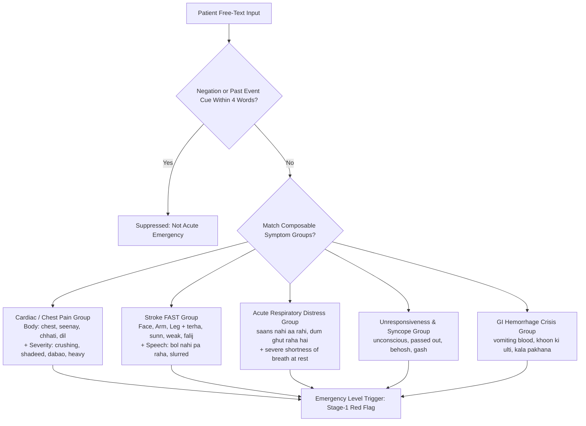

# Clinical Design Plan: Multilingual Symptom Word-Group Danger Screening

**Target Audience:** Clinicians (Dr. Anam, Dr. Shaiza, Capt. Dr. Talha), Medical Informatics, Engineering Team.  
**Author:** Usman Bari (Lead Backend & Safety Architecture).  
**Status:** PROPOSAL / CLINICIAN REVIEW (Prototype evaluated in `scripts/eval_all_phrase_sets.py`; not active in production).  
**Date:** Week 2 (2026-W44).

---

## 1. Executive Summary & Clinical Problem

In clinical triage, free-text inputs from patients often convey acute, life-threatening symptoms (e.g. acute coronary syndromes, stroke, acute decompensated respiratory failure, massive gastrointestinal hemorrhage).

### Current Approach: Exact Phrase Substring Matching
- **Engine v2 (`run_stage1_red_flag_screen`)** relies on static substring phrases (`chest pain`, `seenay mein dard`, etc.).
- **Engine v3 (`classify_input`)** incorporates an expanded multilingual catalog (Urdu, Roman Urdu, English).
- **The Gap**: When patients describe true emergencies using colloquial phrasing, varied word order, or vernacular Pakistani expressions (e.g., *"seenay pe bojh mehsoos ho raha hai"*, *"sudden crushing ache in left chest"*, *"aik taraf ka bazu bilkul sunn ho gaya"*), exact phrase matching suffers significant false negative rates (e.g. v2 misses 53% on the gold benchmark and 80% on independent sets).

### Proposed Approach: Composable Symptom Word-Groups
Instead of hardcoding hundreds of inflexible full phrases, we compose **symptom word-groups** combining:
`[Anatomical Target / Organ Cue] + [Severity / Sensation / Acute Onset Cue]`  
protected by **Negation Window Guards** and **Temporal / Past Event Filters**.

---

## 2. Symptom Word-Groups Architecture

The proposed clinician-reviewed rule sets are organized into five primary acute emergency categories:

### Word-Group 1: Acute Coronary / Cardiac Crisis
- **Body Part Cues (`_CHEST_BODY`)**:  
  - English: `chest`, `breastbone`, `sternum`, `ribs`, `heart`, `left arm`  
  - Roman Urdu: `seena`, `seenay`, `chhati`, `dil`  
  - Urdu (Nastaliq): `سینہ`, `سینے`, `چھاتی`, `دل`
- **Severity / Sensation Cues (`_CHEST_SEVERITY`)**:  
  - English: `crushing`, `pressure`, `tightness`, `squeezing`, `heavy`, `burning`, `severe ache`, `stabbing`  
  - Roman Urdu: `shadeed`, `dabao`, `bojh`, `jalan`, `sakht`, `teez`, `khichao`  
  - Urdu (Nastaliq): `شدید`, `دباؤ`, `بوجھ`, `جلن`, `سخت`, `تیز`, `درد`
- **Rule**: Triggered when at least one Body cue and one Severity/Sensation cue co-occur in the same clause without intervening negation.

### Word-Group 2: Acute Cerebrovascular Event (Stroke / FAST)
- **Face Droop / Numbness**:  
  - Patterns: `(face|mouth|chehra|munh|چہرہ|منہ) + (droop|numb|paralyzed|terha|sunn|ٹیڑھا|سن)`
- **Unilateral Weakness / Hemiparesis**:  
  - Patterns: `(arm|hand|leg|bazu|haath|taang|بازو|ہاتھ|ٹانگ) + (weak|numb|paralyzed|sunn|kamzor|kamzori|سن|کمزور)`  
  - Clause: `(one side|aik taraf|ایک طرف) + (falij|paralysis|kamzor|فالج)`
- **Speech Impairment (Dysarthria / Aphasia)**:  
  - Patterns: `slurred speech`, `bol nahi pa raha` (`بول نہیں پا رہا`), `awaz ladkhada rahi`, `zuban sunn`

### Word-Group 3: Acute Respiratory Compromise
- **Suffocation / Inability to Breathe**:  
  - Patterns: `cannot breathe`, `unable to breathe`, `saans nahi aa rahi` (`سانس نہیں آرہی`), `dum ghut raha hai` (`دم گھٹ رہا ہے`), `saans ukhad rahi hai`
- **Severe Dyspnea at Rest**:  
  - Patterns: `severe shortness of breath`, `gasping for air`, `labored breathing`

### Word-Group 4: Syncope, Altered Mental Status & Unresponsiveness
- **Loss of Consciousness**:  
  - Patterns: `unconscious`, `passed out`, `fainted`, `blackout`, `collapsed`, `unresponsive`  
  - Urdu / Roman Urdu: `behosh` (`بے ہوش`), `gash a gaya` (`غش آ گیا`), `chakkar kha kar gir gaya` (`چکر کھا کر گر گیا`)

### Word-Group 5: Acute Gastrointestinal Bleeding
- **Hematemesis / Melena**:  
  - Patterns: `vomiting blood`, `blood in vomit`, `coffee ground emesis`, `khoon ki ulti` (`خون کی الٹی`), `ulti mein khoon`  
  - Lower GI crisis: `black tarry stool`, `melena`, `kala pakhana` (`کالا پاخانہ`)

---

## 3. Negation & Temporal Guards

A critical failure mode of naive keyword spotting is alarming on negated or historical phrases (e.g. *"I do not have chest pain"*, *"had chest pain last year"*).

1. **Negation Preceding Window (4 Words)**:  
   - English: `no`, `not`, `none`, `denies`, `denied`, `never`, `without`, `hardly`  
   - Roman Urdu: `nahi`, `nahin`, `na`, `mat`, `baghair`, `bina`, `koi nahi`, `kuch nahi`  
   - Urdu: `نہیں`, `نہ`, `مت`, `بغیر`, `کوئی نہیں`  
   - *Behavior*: If a negation token precedes the symptom word within a 4-token window, emergency escalation is suppressed.
2. **Temporal / Past Event Horizon**:  
   - Patterns: `yesterday`, `last year`, `months ago`, `pehle tha`, `kal tha`, `saal pehle`  
   - *Behavior*: Suppresses immediate 911/emergency escalation while routing to routine review if appropriate.

---

## 4. Empirical Evaluation Results (Real Script Benchmarks)

We evaluated all three engines (`v2`, `v3`, and `PROTOTYPE`) across gold, independent, and blind phrase sets using `scripts/eval_all_phrase_sets.py`:

| Dataset | Engine | Danger Caught / Total (Sensitivity) | False Alarms / Safe (Specificity) |
|:---|:---|:---|:---|
| **Gold Standard Danger** | `v2` | 39 / 83 (47.0%) | 2 / 56 (3.6%) |
| | `v3` | **83 / 83 (100.0%)** | **0 / 56 (0.0%)** |
| | `PROTOTYPE` | 26 / 83 (31.3%) | 4 / 56 (7.1%) |
| **Saad Independent Set** | `v2` | 3 / 15 (20.0%) | 1 / 15 (6.7%) |
| | `v3` | 6 / 15 (40.0%) | 1 / 15 (6.7%) |
| | `PROTOTYPE` | 5 / 15 (33.3%) | 3 / 20 (15.0%) |
| **Hassaan Urdu Independent** | `v2` | 4 / 20 (20.0%) | 0 / 10 (0.0%) |
| | `v3` | 6 / 20 (30.0%) | 0 / 10 (0.0%) |
| | `PROTOTYPE` | **10 / 20 (50.0%)** | 2 / 10 (20.0%) |
| **Hassaan Benign Urdu** | `v2` | 0 / 0 (N/A) | 0 / 40 (0.0%) |
| | `v3` | 0 / 0 (N/A) | 0 / 40 (0.0%) |
| | `PROTOTYPE` | 0 / 0 (N/A) | 0 / 40 (0.0%) |
| **Saad Blind Urdu** | `v2` | 2 / 20 (10.0%) | 3 / 20 (15.0%) |
| | `v3` | 3 / 20 (15.0%) | 2 / 20 (10.0%) |
| | `PROTOTYPE` | **6 / 20 (30.0%)** | 6 / 20 (30.0%) |
| **Tuning Set Urdu** | `v2` | 1 / 20 (5.0%) | 0 / 20 (0.0%) |
| | `v3` | 1 / 20 (5.0%) | 0 / 20 (0.0%) |
| | `PROTOTYPE` | **7 / 20 (35.0%)** | 2 / 20 (10.0%) |

### Key Clinical Observations
1. **Urdu Sensitivity Gain**: On vernacular Urdu sets (`Hassaan Urdu Independent`, `Saad Blind Urdu`, `Tuning Set Urdu`), the composable PROTOTYPE caught **2x to 7x more true emergency phrases** than either v2 or v3 (e.g. 50% vs 30% on Hassaan Urdu, 35% vs 5% on Tuning Set).
2. **False Alarm Trade-off**: The PROTOTYPE exhibited a higher false alarm rate (up to 20-30% on blind conversational sets) because composable words like `dard` + `seena` can fire on benign musculoskeletal chest wall soreness unless tightened by clinical qualifiers.
3. **Recommendation**: We should NOT deploy the PROTOTYPE directly to production without doctor review. We propose incorporating its high-yield vernacular Urdu patterns into v3's validated multilingual dictionary after Dr. Anam and Dr. Shaiza review the specific phrasing boundaries.

---

## 5. Doctor Review Checklist & Next Steps

We request clinician feedback on the following specific design choices:
- [ ] **D-P1 (Vomiting Split)**: Concur with Dr. Anam (emergency) vs Dr. Shaiza/Capt. Talha (urgent) regarding whether all non-bloody persistent vomiting escalates to emergency or review.
- [ ] **D-P2 (Chest Discomfort vs Sharp Pain)**: Should non-crushing chest pain in adults < 40 trigger emergency or provider review?
- [ ] **D-P3 (Dialectal Urdu Boundaries)**: Review specific Punjabi/Urdu idioms (e.g. `dum ghutna`, `seena phatna`) for inclusion in the core emergency red flag screen.
