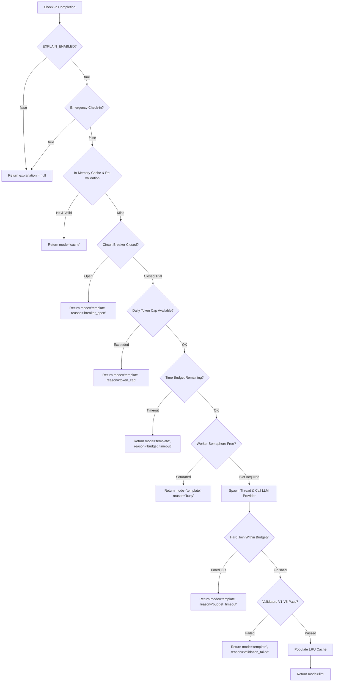

# Explainer Safety Guards Architecture & Operations Guide

**Audience:** Backend Engineers, System Operators, Clinicians, and QA.  
**Feature Flag:** `EXPLAIN_ENABLED` (Default: `false` / OFF).  
**Status:** Active in v1.0.  

---

## 1. Architectural Overview & Motto

> **Motto:** *"The model proposes, the rules decide."*

In ChronicCare AI, clinical decisions (such as triage levels `routine`, `review`, `urgent`, `emergency`) are strictly determined by deterministic clinical rule engines. LLMs **never** determine triage levels, and an explanation **never** alters or overrides a triage decision.

When `EXPLAIN_ENABLED=true`, the Guideline Explainer provides patients with concise, plain-language clinical context derived from verified clinical guidelines (e.g. ADA, ACC/AHA). To ensure patient safety, uptime, and strict cost controls, the explainer is wrapped by hermetic safety guards with dual LLM provider support (Groq and Google Gemini):

---

## 2. Safety Guards Specification

### Guard 1: Hard Time Budget (`EXPLAIN_BUDGET_SECONDS`)
- **Default:** `3.0` s. Bounds: `1.0` s – `10.0` s.
- **Behavior:** The entire explainer pipeline (retrieval, prompt construction, LLM generation, JSON parsing, and safety validation) must complete within the wall-clock budget.
- **Timeout Isolation:** The worker thread executes as a daemon. If `join()` reaches the deadline, the main request thread aborts waiting immediately and returns the pre-verified deterministic template with `mode='template'`, `reason='budget_timeout'`. The patient **never waits longer than budget + 1 s**.
- **Late Thread Accounting:** If a worker thread times out but finishes upstream execution in the background, its token usage is safely credited to the daily token counter under a lock with `recorded` / `consumed_by_caller` flag, while its generated text is permanently discarded.
- **Concurrency Isolation:** A hung LLM thread does not block subsequent check-ins because each check-in uses independent thread isolation bounded by a concurrency semaphore.
- **No Background Retries:** Calls into `chat_with_usage` strictly pass `max_retries=0` and `sdk_max_retries=0` alongside `timeout <= budget` so a timed-out call never retries in the background.

### Guard 2: Daily Token Cap (`EXPLAIN_DAILY_TOKEN_CAP`, `EXPLAIN_DAILY_TOKEN_CAP_GEMINI`)
- **Default:** `150,000` tokens per UTC day (~$0.07–$0.15/day on Groq `llama-3.3-70b-versatile`). Bounds: `10,000` – `1,000,000`.
- **Separate Per-Provider Caps:** Groq and Gemini track cumulative prompt and completion tokens separately. When `used_tokens + 1,000 > cap` for a provider, that provider is skipped.
- **Rollover:** The counter resets automatically at 00:00:00 UTC.

### Guard 3: In-Memory Bounded LRU Cache & Strict Safety Re-validation (`EXPLAIN_CACHE_MAX`, `EXPLAIN_CACHE_TTL_SECONDS`)
- **Capacity & TTL:** Bounded 500-item LRU cache (`EXPLAIN_CACHE_MAX=500`), 24-hour TTL (`EXPLAIN_CACHE_TTL_SECONDS=86400.0`).
- **Privacy Preservation:** Cache keys are strictly abstract categorical tuples:
  `[trigger_category, triage_level, glucose_band, bp_band, language, condition]`
  **Cache keys never contain user IDs, patient names, dates of birth, or raw vital reading values.**
- **Strict Safety Re-validation (A3):** Cached entries are **never blindly reused**. On every cache hit, the entry undergoes rigorous re-validation against the current check-in context:
  1. **Source Existence:** All cited chunk IDs must exist in the active guideline store.
  2. **Citation Grounding:** Re-runs citation validator V2.
  3. **Number Grounding:** Re-runs numerical grounding V3 against the **current** patient's allowed numbers. If the cached text mentions a numerical value not present in the current readings, re-validation rejects the hit as a miss and dispatches to the LLM.
  4. **Banned Patterns & Level Consistency:** Re-runs validators V4 and V5 against the decided triage level.
- **Template Exclusion:** Errors and template fallbacks are never cached.

### Guard 4: Circuit Breaker (`EXPLAIN_BREAKER_FAILURES`, `EXPLAIN_BREAKER_COOLDOWN_SECONDS`)
- **Threshold & Cooldown:** 3 consecutive failures (`EXPLAIN_BREAKER_FAILURES=3`) trip the breaker to `OPEN` for a 600.0-second cooldown (`EXPLAIN_BREAKER_COOLDOWN_SECONDS=600.0`).
- **Instant Rate-Limit Trip:** Any HTTP 429 (`RateLimitError` or `"rate limit"`) trips the breaker immediately on the first occurrence.
- **Validator Independence:** Rejection by clinical safety validators (V1–V5) indicates correct validator function, **not** upstream infrastructure failure; validator rejections do **not** record breaker failures.
- **Half-Open Trial:** Once cooldown expires, the breaker transitions to `HALF_OPEN` and permits exactly 1 trial call. If the trial succeeds, the breaker resets to `CLOSED`. If it fails, the breaker trips back to `OPEN`.
- **Per-Provider Breakers:** Groq and Gemini maintain independent circuit breaker instances (`_GLOBAL_BREAKER_GROQ` and `_GLOBAL_BREAKER_GEMINI`).

### Guard 5: BM25 Retriever Reuse & Thread-Safe Caching (A5)
- **Behavior:** The Okapi BM25 retriever index is built once and cached in memory. Subsequent check-ins reuse the pre-indexed structure in $\mathcal{O}(1)$ time rather than re-indexing guideline text on every check-in. If the underlying chunk store changes (detected by store instance ID or total chunk count), the cache invalidates and rebuilds automatically.

### Guard 6: Dual LLM Providers & Failover Routing (`LLM_PROVIDER`, `LLM_PROVIDER_ORDER`)
- **Dual Providers:** ChronicCare AI supports two production-grade LLM providers for the explainer: **Groq** (`llama-3.3-70b-versatile`) and **Google Gemini** (configured via `GEMINI_MODEL`, e.g. `gemini-2.5-flash`).
- **Failover Routing:** When `LLM_PROVIDER=auto` (default), the system attempts providers in the sequence defined by `LLM_PROVIDER_ORDER` (default `groq,gemini`). If the primary provider encounters an HTTP 429 rate limit, network timeout, or connection error, the system immediately fails over to the next candidate provider.
- **Budget Splitting:** When a fallback provider is available in auto mode, the primary provider is allocated 60% of the remaining `EXPLAIN_BUDGET_SECONDS` (at least 1.0 s), reserving the remaining 40% (at least 1.0 s) for the fallback candidate. If a single provider is configured or no fallback remains, the active provider receives 100% of the remaining budget.
- **Independent Breakers & Caps:** Groq and Gemini maintain completely independent daily token counters (`EXPLAIN_DAILY_TOKEN_CAP` and `EXPLAIN_DAILY_TOKEN_CAP_GEMINI`, both default 150,000 tokens) and independent circuit breaker instances (`_GLOBAL_BREAKER_GROQ` and `_GLOBAL_BREAKER_GEMINI`). Saturating or tripping one provider does not affect the other.
- **Free Tier Data Advisory:**
  > [!IMPORTANT]
  > Gemini free tier: Google may use prompts and responses to improve its products and human reviewers may read them. Fake/test data only. Real patient data requires the paid tier.

### Guard 7: Guideline Licence Restrictions (G3)
- **Zero-Leak Licence Enforcement:** Certain proprietary clinical guidelines (e.g. ADA Standards of Care, ACC/AHA) carry distribution licences that forbid transmitting text to third-party generative models that may retain prompt data. These sources are marked `allowed_for_rag == FALSE` in `docs/GUIDELINE_CORPUS.md` (`ada_2026_sec02`, `ada_2026_sec05`, `ada_2026_sec06`, `ada_2026_sec10`, `ada_2026_sec11`, `ada_2026_sec13`, `aha_acc_2025`).
- **Provider Filtering:** If ANY candidate retrieved chunk originates from a licence-restricted source, Google Gemini is strictly disallowed for that request. In `auto` mode, Gemini is quietly pruned from the candidate list (Groq is attempted); if Gemini was explicitly requested (`LLM_PROVIDER=gemini`), the system immediately falls back to verified deterministic templates with `reason='licence_restricted'`.

### Guard 8: Condition Safety Filter (H1)
- **Diabetes Template-Only:** Based on clinical review, diabetes clinical explanations are restricted to pre-verified deterministic templates (`reason='condition_template_only'`).
- **Eligible Conditions:** Only conditions configured in `EXPLAIN_LLM_CONDITIONS` (default `hypertension`) are permitted to invoke generative LLMs.
- **Dual-Condition Handling:** For patients diagnosed with both diabetes and hypertension, the LLM is invoked ONLY if the primary trigger for the check-in is an elevated blood pressure trigger (`bp_systolic_urgent`, `bp_diastolic_urgent`, `bp_both_urgent`, `bp_systolic_elevated`, `bp_diastolic_elevated`, `bp_both_elevated`, `bp_normal`). If the trigger is glucose-related or routine, deterministic templates are returned.

### Guard 9: Deterministic Template Consistency Guard (H2)
- **Reading-Template Alignment:** Whenever a deterministic template is selected, `is_template_consistent` validates that the template language does not contradict actual numerical vitals (e.g., normal BP or normal glucose paired with an urgent/high template).
- **Automatic Correction:** If an inconsistency is detected (e.g. a routine check-in paired with a high-blood-pressure template due to trigger misalignment), the system automatically substitutes a neutral routine template for that language with `reason='template_corrected'`.

---

## 3. Environment Variables Reference

| Variable | Type | Default | Valid Range | Purpose |
|---|---|---|---|---|
| `EXPLAIN_ENABLED` | bool | `false` | `true`, `false` | Master feature flag. When `false`, zero guard or LLM code runs and `explanation` is `null`. |
| `EXPLAIN_BUDGET_SECONDS` | float | `3.0` | `1.0` – `10.0` | Hard wall-clock execution budget in seconds. |
| `EXPLAIN_DAILY_TOKEN_CAP` | int | `150000` | `10000` – `1000000` | Maximum Groq total tokens allowed per UTC calendar day. |
| `EXPLAIN_DAILY_TOKEN_CAP_GEMINI` | int | `150000` | `10000` – `1000000` | Maximum Gemini total tokens allowed per UTC calendar day. |
| `EXPLAIN_CACHE_MAX` | int | `500` | `50` – `5000` | Maximum number of entries stored in the LRU explanation cache. |
| `EXPLAIN_CACHE_TTL_SECONDS` | float | `86400.0` | `60.0` – `604800.0` | Time-to-live for cached validated explanations in seconds. |
| `EXPLAIN_BREAKER_FAILURES` | int | `3` | `1` – `10` | Number of consecutive upstream errors before opening circuit breaker. |
| `EXPLAIN_BREAKER_COOLDOWN_SECONDS` | float | `600.0` | `5.0` – `3600.0` | Cooldown duration before attempting a trial call in half-open state. |
| `EXPLAIN_POOL_MAX_WORKERS` | int | `8` | `4` – `32` | Maximum concurrent background LLM worker threads. |
| `LLM_PROVIDER` | str | `auto` | `auto`, `groq`, `gemini` | Explainer LLM provider routing mode (`auto` falls back through `LLM_PROVIDER_ORDER`). |
| `LLM_PROVIDER_ORDER` | str | `groq,gemini` | comma-separated list | Provider failover order when `LLM_PROVIDER=auto`. |
| `GEMINI_MODEL` | str | `""` | string | Google Gemini model ID (e.g. `gemini-2.5-flash`). Required if using Gemini. |
| `GEMINI_THINKING_BUDGET` | str | `""` | int string (e.g. `0`) | Optional Gemini thinking budget. If set, passed in generationConfig. |
| `EXPLAIN_LLM_CONDITIONS` | str | `hypertension` | comma-separated list | Clinical conditions eligible for LLM explanations (diabetes is template-only). |

---

## 4. In-Memory vs. Persistent State Justification

In the ChronicCare AI prototype, all guard states (token counters, circuit breaker states, LRU cache, worker semaphores) are stored **in-memory**:
1. **Zero Database Migrations:** Requires no extra tables, Redis clusters, or foreign keys in SQLite / MySQL.
2. **Hermetic Resilience:** Process restarts safely reset counters and circuit breakers. If a deployment had an unhealthy upstream connection that is resolved during a deploy, the circuit breaker resets cleanly.
3. **Low Latency:** In-memory checks complete in under 5 microseconds ($\\mu\\text{s}$), adding zero overhead to the check-in completion path.
4. **Safety Invariance:** In-memory cache re-validation guarantees that even if state is restored or warmed, no patient can ever receive mismatched numerical readings.

---

## 5. Patient View vs. Provider Review View

The presentation of the explanation is strictly segregated between patient and provider endpoints:

| Dimension | Patient View (`POST /api/checkins/{id}/complete`) | Provider View (`GET /api/provider/review/{id}`) |
|---|---|---|
| **Tone & Style** | Reassuring, calm, plain-language (max 35 words/sentence). | Formal clinical summary with audit metadata. |
| **Citations** | Shown with public titles (e.g. ADA 2024 Glycemic Targets). | Includes full chunk IDs, section paths, and guideline editions. |
| **Probability & ML** | **Strictly absent.** Never includes percentages or logits. | Includes full quantitative probability, model versions, and caveats. |
| **Rejection Audit** | Not shown (returns pre-verified template without error traces). | `rejected_reasons` array details any validator checks that failed. |
| **Mode & Reason** | **Strictly absent.** (sentences + sources only). | Full explainer metadata including delivery mode and reason code. |
| **Provider Trace** | **Strictly absent.** | `provider` and `providers_tried` audit trails recorded. |

---

## 6. Troubleshooting & Fallback Reason Codes

Whenever `mode == "template"`, the `reason` field indicates why deterministic fallback was selected:

| Reason Code | Root Cause | Operator Action |
|---|---|---|
| `budget_timeout` | LLM latency exceeded `EXPLAIN_BUDGET_SECONDS` (3.0 s). | Check provider API status. If network latency is elevated, increase `EXPLAIN_BUDGET_SECONDS` to 5.0 s. |
| `token_cap` | Daily token usage reached provider token cap (150,000). | Normal cost-cap operation. Check token usage via `get_explain_guard_metrics()`. Reset occurs at 00:00 UTC. If traffic has grown, increase cap. |
| `breaker_open` | 3 consecutive timeouts or connection errors tripped circuit breaker. | Inspect upstream provider logs. The breaker will test a trial call after 600 seconds. |
| `rate_limited` | HTTP 429 Too Many Requests received from provider. | Rate tier saturated. Breaker opened immediately for 600 s cooldown to allow token bucket refill. |
| `validation_failed` | Generated text failed clinical validator (V1 structure, V2 citation, V3 numbers, V4 forbidden phrase, or V5 level mismatch). | Normal safety behavior. The system safely suppressed ungrounded text and delivered deterministic clinical guidance. |
| `no_llm` | API key is not configured or LLM client initialization failed. | Configure `GROQ_API_KEY` and/or `GEMINI_API_KEY` in environment. |
| `no_chunks` | Retrieval returned 0 relevant guideline chunks for this condition. | Check database seeding (`init_local_db.py`). |
| `busy` | All worker semaphore slots (`EXPLAIN_POOL_MAX_WORKERS`) are in use. | High concurrent traffic spike. Increase `EXPLAIN_POOL_MAX_WORKERS` (default 8). |
| `licence_restricted` | Retrieved guideline chunk is from a restricted licence corpus (G3) and Gemini cannot be used. | Normal safety behavior. The system falls back to verified deterministic templates or alternative providers. |
| `condition_template_only` | Check-in condition is not in `EXPLAIN_LLM_CONDITIONS` (e.g. diabetes). | Normal clinical safety behavior. Diabetes explanations are deterministic template-only. |
| `template_corrected` | Deterministic template contradicted actual vitals and was replaced with neutral routine template. | Normal safety invariant enforcement. Check trigger mapping logic. |
| `error` | Upstream JSON deserialization or network socket exception. | Inspect backend application error logs. |

---

## 7. Go-Live Checklist (When Flipping `EXPLAIN_ENABLED=true` in Production)

Before enabling the patient-facing explainer in production:

- [ ] **1. Guideline Chunks Loaded:** Verified that clinical guideline chunks are loaded and seeded in production database (`init_local_db.py` / migrations).
- [ ] **2. Explainer Evaluation Reviewed:** Saad's explainer clinical evaluation has been reviewed and signed off by the clinical team.
- [ ] **3. Live Smoke Output Verified:** Usman's live smoke output for `groq` AND `gemini` pasted and verified (`python scripts/explain_live_smoke.py --provider auto`).
- [ ] **4. Production Environment Variables Provisioned (Render):**
  - `EXPLAIN_ENABLED=true`
  - `LLM_PROVIDER=auto`
  - `GROQ_API_KEY` (configured in Render secret environment)
  - `GROQ_MODEL` (configured in Render environment)
  - `GEMINI_API_KEY` (configured in Render secret environment)
  - `GEMINI_MODEL` (configured in Render environment)
  - `EXPLAIN_LLM_CONDITIONS=hypertension`
- [ ] **5. Token Caps and Budget Verified:**
  - `EXPLAIN_BUDGET_SECONDS` is set to `3.0` (p95 latency under 3.5 s verified via `measure_explain_latency.py`).
  - `EXPLAIN_DAILY_TOKEN_CAP` set (default 150,000 tokens).
  - `EXPLAIN_DAILY_TOKEN_CAP_GEMINI` set (default 150,000 tokens).
- [ ] **6. Gemini Free Tier Advisory Confirmed:** Confirmed team awareness:
  *"Gemini free tier: Google may use prompts and responses to improve its products and human reviewers may read them. Fake/test data only. Real patient data requires the paid tier."*
- [ ] **7. Cache & Breaker Monitoring:** Verify observability checks on `/api/health` or metrics output alert when any `breaker_state != "closed"`.
- [ ] **8. Emergency Invariant Confirmed:** Verify that emergency check-ins always receive `explanation = null`.\n