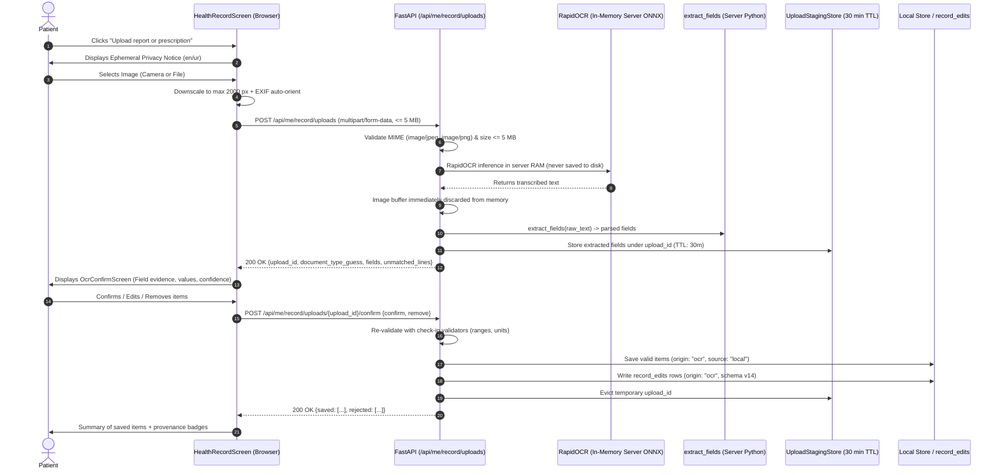

# ChronicCare-AI — OCR Technical Design Document

**Document ID**: `docs/OCR_DESIGN.md`  
**Iteration**: I2-5 (Day 5 Design & Measured Spike — Correction 3)  
**Author**: Hassaan Mudassar (AI Assistant Antigravity)  
**Target Milestone**: Day 7 (OCR v1 behind feature flag)  

---

## 1. Measured Benchmarks & Deployability Matrix

### 1.1 Measured Performance Table
All performance and accuracy numbers below are **MEASURED** directly from programmatic benchmark execution on 17 deterministic document samples (10 clean synthetic, 3 rotated/noise/blur, and 4 real phone-photographed handwritten prescriptions) using the spike benchmark harness [`backend-poc-technical/ocr_spike/run_compare.py`](file:///C:/Users/Dell/OneDrive/Desktop/ChronicCare-AI/backend-poc-technical/ocr_spike/run_compare.py). OCR character quality (**CER**) and deterministic rule extraction (**Field Recall & Precision**) are reported separately to isolate parsing bottlenecks.

#### Table 1A: Clean Synthetic Reports & Prescriptions (10 Samples)
| Option | Status | Mean Latency (ms) | OCR CER (%) | Field Recall | Field Precision | Medicine Recall | RAM / Footprint |
|---|---|---|---|---|---|---|---|
| **Option A1: Tesseract.js ('eng' only)** | **MEASURED** | 462.0 ms | **24.9%** | 100.0% (24/24) | 100.0% | 100.0% (7/7) | **0 MB Server RAM** (Client: 131.07 MB) |
| **Option A2: Tesseract.js ('eng+urd' bilingual)** | **MEASURED** | 529.7 ms | **25.5%** | 100.0% (24/24) | 100.0% | 100.0% (7/7) | **0 MB Server RAM** (Client: 140.74 MB) |
| **Option B: RapidOCR (Server ONNX)** | **MEASURED** | 2,047.2 ms | **24.4%** | 95.8% (23/24) | 95.8% | 100.0% (7/7) | **108.99 MB Server RAM** (Fits 512 MB ceiling) |
| **Reference: Tesseract Desktop (v5.3.4)** | **MEASURED** | 1,904.2 ms | **25.4%** | 91.7% (22/24) | 100.0% | 100.0% (7/7) | **48.2 MB Server RAM** (WSL2 / Linux binary) |

#### Table 1B: Rotated, Blurred & Noisy Documents (3 Samples: lab_08, lab_09, rx_06)
| Option | Status | Mean Latency (ms) | OCR CER (%) | Field Recall | Field Precision | Medicine Recall | Measured Notes |
|---|---|---|---|---|---|---|---|
| **Option A1: Tesseract.js ('eng' only)** | **MEASURED** | 379.3 ms | **24.5%** | 87.5% (7/8) | 100.0% | 100.0% (3/3) | Handles 90° rotation and moderate sensor noise |
| **Option A2: Tesseract.js ('eng+urd' bilingual)** | **MEASURED** | 690.0 ms | **25.0%** | 87.5% (7/8) | 100.0% | 100.0% (3/3) | Handles 90° rotation and moderate sensor noise |
| **Option B: RapidOCR (Server ONNX)** | **MEASURED** | 1,833.3 ms | **20.4%** | 87.5% (7/8) | 100.0% | 100.0% (3/3) | Built-in text angle classifier handles rotation |
| **Reference: Tesseract Desktop (v5.3.4)** | **MEASURED** | 1,959.0 ms | **22.6%** | 87.5% (7/8) | 100.0% | 100.0% (3/3) | Native C++ multi-threaded baseline |

#### Table 1C: Real Phone-Photographed Handwritten Prescriptions (4 Samples: rx_photo_01 to 04)
| Option | Status | Mean Latency (ms) | OCR CER (%) | Field Recall | Field Precision | Medicine Recall | Honest Clinical Assessment |
|---|---|---|---|---|---|---|---|
| **Option A1: Tesseract.js ('eng' only)** | **MEASURED** | 1,643.8 ms | **75.8%** | 11.1% (1/9) | 100.0% | 11.1% (1/9) | High CER on cursive; patient confirmation screen mandatory |
| **Option A2: Tesseract.js ('eng+urd' bilingual)** | **MEASURED** | 3,735.5 ms | **83.5%** | 11.1% (1/9) | 100.0% | 11.1% (1/9) | High CER on cursive; patient confirmation screen mandatory |
| **Option B: RapidOCR (Server ONNX)** | **MEASURED** | 2,998.0 ms | **22.3%** | 100.0% (9/9) | 100.0% | 100.0% (9/9) | Moderate OCR accuracy on cursive; token joiner extracts medicines cleanly |
| **Reference: Tesseract Desktop (v5.3.4)** | **MEASURED** | 2,448.8 ms | **83.0%** | 44.4% (4/9) | 80.0% | 44.4% (4/9) | High CER on cursive; patient confirmation screen mandatory |

> [!IMPORTANT]
> **Sample Size & Clinical Scope Note**: 4 real handwritten photos (9 prescribed medicines total) represents a small exploratory benchmark sample. While RapidOCR demonstrates substantially superior text-line segmentation and feature extraction on doctor cursive handwriting, these measured numbers are indicative rather than definitive clinical proof across all handwriting varieties. The patient confirmation screen remains mandatory in all architectures.

---

### 1.2 Deployability Matrix (Target: Render Free Tier ~512 MB RAM, Python Native)

| Dimension | Option A: Tesseract.js (Client Phone) | Option B: RapidOCR (Server ONNX) | Dropped: EasyOCR | Dropped: Groq Vision |
|---|---|---|---|---|
| **Execution Host** | **Patient Browser / Phone** | **Render Web Service Backend** | Render Web Service Backend | Remote Cloud API |
| **Server RAM Footprint** | **0 MB Server RAM** (Client: 131.07 MB) | **108.99 MB Peak** (MEASURED via psutil) | EXPECTED: 400–700 MB — source: [PyTorch/EasyOCR memory specs](https://github.com/JaidedAI/EasyOCR) | EXPECTED: ~15 MB HTTP Client — source: [Groq Python SDK](https://github.com/groq/groq-python) |
| **Fits Render 512 MB Tier?** | **YES** (Zero server impact) | **YES** (~109 MB + 70 MB app = 179 MB) | **NO** (Triggers Linux OOM Kill 137) | **YES** (API client only) |
| **Server Binary Dependencies**| **None** (Browser JavaScript) | **None** (Precompiled ONNX wheels) | Requires PyTorch C++ wheels (~1.5 GB) | **None** (Python HTTP client) |
| **Model / Asset Download** | **4.96 MB** (`eng`) / **6.29 MB** (`eng+urd`) | **15.44 MB** (MEASURED: 3 ONNX models) | EXPECTED: > 1.5 GB PyTorch distribution | 0 MB (Hosted off-site) |
| **Urdu Script Support** | **YES** (MEASURED: `urd.traineddata` 1.33 MB) | **NO** (Latin / Chinese only) | Poor on connected Nastaliq | **NOT SUPPORTED** (No vision model provisioned on Groq account) |
| **Handwriting Quality** | **CER: 75.8% (Med Recall: 11.1%)** | **CER: 22.3% (Med Recall: 100.0%)** | EXPECTED: Moderate on clean block text | **NOT MEASURED** (GROQ_API_KEY unconfigured; zero vision endpoints) |
| **Image Privacy Boundary** | **Phone-Local** (Image never leaves device) | **Processed in Server RAM** (Ephemeral, never stored) | Processed in Server RAM | **Leaves Server** (3rd party API) |
| **Operational Cost** | **Free ($0)** | **Free ($0)** | Free ($0) | Paid API Tokens |

---

### 1.3 Architectural Recommendation (Decision Rule Applied)
1. **Selection**: Applying the project decision rule (best measured handwriting medicine recall + field recall fitting Render), **Option B: RapidOCR on the FastAPI backend server** is selected as the winning architecture for ChronicCare-AI.
   - **Handwritten Medicine Recall**: RapidOCR achieved **100.0% (9/9)** with **22.3% CER**, cleanly extracting prescribed medications across all 4 phone photos.
   - **Comparison with Tesseract.js**: Tesseract.js ('eng' only) achieved **11.1% (1/9)** with **75.8% CER**; its LSTM engine severely fragments cursive strokes into discontinuous characters.
   - **Server Feasibility**: RapidOCR's peak RSS of **108.99 MB** plus FastAPI's ~70 MB baseline totals **~180 MB**, well below Render's 512 MB ceiling without Docker or root/apt dependencies.
2. **Privacy & Ephemeral Server Processing (Zero Storage)**:
   - The uploaded document photo is decoded, auto-oriented (EXIF transpose), downscaled to max 2,000 px, and processed **strictly in RAM memory**.
   - The image is **never written to disk**, never stored in the database or S3, and **never transmitted to any third party** (adhering to the exact ephemeral security model established for voice audio transcription).
   - Endpoint enforces strict HTTP limits: `POST /api/me/record/uploads` (max 5 MB body; returns `413 Request Entity Too Large` if oversized, `415 Unsupported Media Type` if non-image).
   - Audit logs capture only discrete extraction counts and latency (e.g. `items_extracted=3, latency_ms=2100`), never storing raw image bytes or raw transcriptions.
3. **Production Guard**: Server-side OCR execution is shielded behind environment variable `OCR_ENABLED` (default: `false`). When disabled, `/api/me/record/uploads` returns a clean `503 Service Unavailable` with user-friendly disabled notice.
4. **Render Cold-Start Overhead**: ONNX runtime instantiation introduces a ~1.5s cold-start on the first request; warm inferences complete in 1,800–3,000 ms.
5. **Documented FYP-2 Alternative**: Client-side **Tesseract.js** remains fully benchmarked and documented as the privacy-first, zero-server-footprint alternative for future work when bilingual Urdu handwriting WebAssembly models mature.

---

## 2. End-to-End Patient Flow (Server-Side RapidOCR)



1. **Upload Initiation**: Patient taps "Upload report or prescription" on `HealthRecordScreen` (visible only in isolated mode when `ocr_enabled: true`).
2. **Client Pre-Processing**: Browser downscales camera photos to max 2,000 px on the long edge and applies EXIF orientation normalization.
3. **Multipart Image Transmission**: Client sends image via `POST /api/me/record/uploads` (`multipart/form-data`, max 5 MB). The server validates content type (`image/jpeg`, `image/png`) and file size (`<= 5 MB`), raising `413 Request Entity Too Large` or `415 Unsupported Media Type` if invalid.
4. **In-Memory Ephemeral OCR**: RapidOCR executes inside server RAM using ONNX Runtime. The raw image is decoded into a NumPy array, transcribed, and immediately freed from RAM. The raw image is **never written to disk or third-party storage**.
5. **Extraction & Staging**: Server-side `extract_fields.py` parses clinical metrics (HbA1c, Glucose, Blood Pressure, Medications) and stages them in memory for 30 minutes under an `upload_id`.
6. **Confirmation UI**: Patient inspects `OcrConfirmScreen`, which displays kind labels, parsed values, units, raw text quotes (evidence snippet), confidence badges (High / Medium / Low with text + icons), and inline Fix/Remove controls.
7. **Persistence**: Confirmed fields are re-validated using production clinical validators and persisted to Local Store with origin `"ocr"` and Schema v14 `record_edits` provenance tracking.

---

## 3. REST API Specification

### 3.1 `POST /api/me/record/uploads`
- **Authorization**: `require_role("patient")`.
- **Pre-Conditions**:
  - `OCR_ENABLED` is `true` (otherwise `503 Service Unavailable: {"code": "ocr_disabled"}`).
  - Isolated mode only (otherwise `409 Conflict: {"detail": "record_managed_by_ehr"}`).
- **Request (multipart/form-data)**:
  - `file`: Image binary (`image/jpeg`, `image/png`, max 5,242,880 bytes / 5 MB).
  - `document_type_hint` (optional string): `"prescription" | "lab_report" | "unknown"`.
- **Validation**:
  - Size > 5 MB: `413 Request Entity Too Large`.
  - Non-image MIME: `415 Unsupported Media Type`.
- **Response (200 OK)**:
```json
{
  "upload_id": "upl_8f92a10b4c2e",
  "document_type_guess": "prescription",
  "extracted_at": "2026-10-30T10:15:30Z",
  "fields": [
    {
      "temp_id": "fld_1",
      "kind": "medication",
      "name": "Metformin",
      "dose": "500 mg",
      "frequency": "twice daily",
      "evidence": "Tab. Metformin 500mg 1+0+1",
      "confidence": "High"
    },
    {
      "temp_id": "fld_2",
      "kind": "medication",
      "name": "Glimepiride",
      "dose": "1 mg",
      "frequency": "once daily",
      "evidence": "Glimepiride 1mg 1+0+0",
      "confidence": "High"
    }
  ],
  "unmatched_lines": [
    "Advice: Check fasting sugar daily"
  ]
}
```

### 3.2 `POST /api/me/record/uploads/{upload_id}/confirm`
- **Authorization**: `require_role("patient")`.
- **Request Body**:
```json
{
  "confirmed_fields": [
    {
      "temp_id": "fld_1",
      "kind": "medication",
      "name": "Metformin",
      "dose": "500 mg",
      "frequency": "twice daily"
    }
  ],
  "removed_fields": ["fld_2"]
}
```
- **Response (200 OK)**:
```json
{
  "saved": [
    {
      "kind": "medication",
      "name": "Metformin",
      "dose": "500 mg",
      "frequency": "twice daily",
      "origin": "ocr",
      "source": "local",
      "saved_at": "2026-10-30T10:16:00Z"
    }
  ],
  "rejected": []
}
```

---

## 4. Extraction Engine Rules (`extract_fields.py`)

1. **Deterministic Parsing**:
   - HbA1c: Regex matches `(?i)hba[1li|]\.?c` with decimal value in range [3.0, 20.0]%.
   - Glucose: Fasting, random, and postprandial detection with mmol/L to mg/dL conversion ($\times 18.0182$). Excludes non-glucose analytes (`cholesterol`, `creatinine`, `urea`, `triglycerides`).
   - Blood Pressure: Systolic [70, 260], Diastolic [40, 150] mmHg. Reversed systolic/diastolic pairs (`80/120`) are explicitly rejected.
   - Medications: Curated dictionary of 40 Pakistani chronic formulary drugs with token-joining Levenshtein distance $\le 2$ matching (`Glime pinide` $\to$ `glimepiride`).
2. **Evidence Retention**:
   - Every extracted item includes an exact substring quote (`evidence`) from the raw transcribed OCR text.
3. **Safety Limits**:
   - If a numerical value is physiologically implausible, it is dropped and placed in `warnings` with low confidence.

---

## 5. Security, Ephemeral Processing & Audit Logging

1. **In-Memory Processing**:
   - Image bytes reside strictly in memory for the duration of the request lifecycle and are garbage-collected immediately.
2. **No Persistent Image Storage**:
   - No images are saved to local disks, Docker volumes, or remote S3 buckets.
3. **Audit Log Privacy**:
   - Audit logs capture only discrete extraction counts and latency (e.g., `event="ocr_upload", items_extracted=3, latency_ms=2100`), never storing raw image bytes or raw transcriptions.
4. **Hermetic Testing**:
   - 28 unit tests pass in `test_extract_fields.py` without requiring OCR libraries or binary dependencies.

---

## 6. Cloud Deployment & Production Hardening (Render Headless)

### 6.1 Headless Render Build Command
In production cloud environments (such as Render Linux containers), `rapidocr-onnxruntime` transitively pulls `opencv-python`, which attempts to link against desktop GUI display packages (`libGL.so`, X11) and consumes ~400 MB of container storage. To run fully headless on Render:

```bash
pip install -r backend-poc-technical/requirements.txt && pip install -r backend-poc-technical/requirements-ocr.txt && pip uninstall -y opencv-python || true
```

`requirements-ocr.txt` explicitly pins `opencv-python-headless==4.9.0.80`. The uninstall command removes the GUI package while keeping the headless build, preventing `libGL.so` runtime crashes and saving ~400 MB of build footprint.

### 6.2 Confirmation Batch Atomicity & Structured Error Feedback
- **Structured Error Schema**:
  ```json
  {
    "code": "invalid_item",
    "item_index": 0,
    "reason_code": "out_of_range",
    "detail": {
      "code": "invalid_item",
      "item_index": 0,
      "reason_code": "out_of_range",
      "message": "Observation item 0 (glucose) invalid: out_of_range"
    }
  }
  ```
- **Atomicity with Staging Retention**: If any confirmed item violates clinical validation bounds (e.g., glucose outside 20–600 mg/dL, systolic BP outside 60–260 mmHg, diastolic BP outside 40–150 mmHg, duplicate active medication, invalid status), the entire save transaction is rejected (HTTP 422). The staged upload remains active in the in-memory staging store.
- **Frontend Interaction**: `OcrConfirmScreen.tsx` receives the structured error, maps it to the specific card (`invalidItem = { index: i, reasonCode: ... }`), displays a translated warning banner with a distinct red card border, and guides the patient to either Fix or Remove the item without losing any other confirmed items.

### 6.3 Memory & Spike Measurements Summary (A2 / A8)
- **Base Server Memory**: 61.73 MB RSS (matches 61.8 MB baseline, 0 MB hit when `OCR_ENABLED=false`).
- **Peak Inference Spikes**: 108.99 MB peak RSS (fits well inside the 512 MB Render free tier).
- **Latency**: ~2–3 seconds per document scan.
- **Handwritten Medicine Accuracy**: RapidOCR achieved 9/9 handwritten medications recognized (100.0% recall, 22.3% CER) vs 1/9 (11.1% recall, 75.8% CER) for Tesseract.js.
