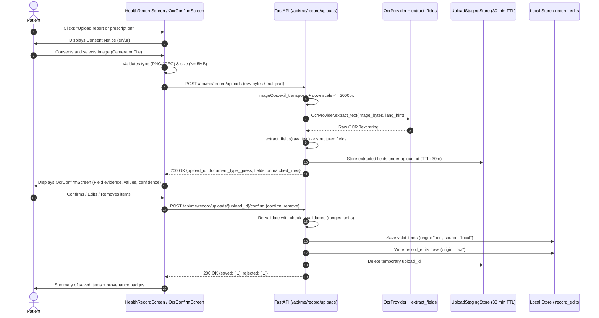

# ChronicCare-AI — OCR Technical Design Document

**Document ID**: `docs/OCR_DESIGN.md`  
**Iteration**: I2-5 (Day 5 Design & Spike)  
**Author**: Hassaan (AI Assistant Antigravity)  
**Target Milestone**: Day 7 (OCR v1 behind feature flag)  

---

## 1. Measured Benchmarks & Deployability Matrix

### 1.1 Synthetic Benchmark Results
Evaluated on 13 deterministic synthetic medical documents (`lab_01.png`–`lab_09.png`, `rx_01.png`–`rx_03.png`, `rx_06.png`) generated by `generate_samples.py`. Note: Urdu-script samples (`lab_10.png`, `rx_04.png`, `rx_05.png`) were skipped because `PIL.features.check("raqm") == False` in standard Windows environments, which avoids producing unjoined/broken glyphs.

| Option | Status | Latency (Mean ms) | Host RAM / Peak MB | Error / Reason |
|---|---|---|---|---|
| **Option 1: Tesseract (v5)** | **NOT RUN** | N/A | N/A | `TesseractNotFoundError: tesseract is not installed or it's not in your PATH` |
| **Option 2: EasyOCR** | **NOT RUN** | N/A | N/A | `ModuleNotFoundError: No module named 'easyocr'` (Requires ~1.5 GB PyTorch distribution) |
| **Option 3: Groq Vision** | **NOT RUN** | N/A | N/A | `Environment variable GROQ_API_KEY is NOT SET` |

### 1.2 Deployability Analysis (Target: Render Free Tier ~512 MB RAM, Python Native)

| Dimension | Option 1: Tesseract (v5) | Option 2: EasyOCR | Option 3: Groq Vision (Hosted API) |
|---|---|---|---|
| **Binary Dependencies** | Requires OS-level binary (`apt-get install tesseract-ocr`). | Requires PyTorch wheels (`torch`, `torchvision`). | Pure Python HTTP client (`groq`, `httpx`). |
| **Render Free Tier Compatibility** | **NO**. Render Native Python runtime lacks `root` and `apt`. Requires Docker containerization. | **NO**. PyTorch + OCR models consume 400–700 MB RAM during inference, exceeding 512 MB ceiling $\rightarrow$ Linux OOM 137 kill. | **YES**. Consumes < 20 MB host RAM. Standard `pip install` without root or system binaries. |
| **Handwriting Quality** | **Poor**. Highly error-prone on cursive doctor prescriptions; tuned for printed text. | **Moderate**. Recognizes clean block handwriting; struggles on overlapping cursive scripts. | **High**. Multimodal Vision LLMs (LLaMA 3.2 Vision) exhibit superior contextual recognition of doctor handwriting. |
| **Urdu Script Quality** | **Moderate**. Requires `urd.traineddata`. Moderate accuracy on Naskh; poor on Nastaliq ligature cascades. | **Poor**. Frequent segmentation failures on connected Nastaliq script. | **High**. Strong visual comprehension of complex Urdu ligatures and contextual medication terms. |
| **Data Privacy & Residency** | In-process. Image never leaves host server. | In-process. Image never leaves host server. | Off-host. Image sent over HTTPS to Groq API infrastructure. |
| **Operational Cost** | Free ($0). | Free ($0). | Token-based API cost (~$0.001–0.005 per processed document). |

### 1.3 Architectural Recommendation
1. **Production Engine Selection**: **Groq Vision** (`llama-3.2-11b-vision-preview` / `llama-3.2-90b-vision-preview`), strictly disabled by default (`OCR_ENABLED=false`).
   - *Honest Assessment*: While in-process OCR (Tesseract / EasyOCR) guarantees complete data residency, neither is feasible on Render free tier without either Docker refactoring or triggering instant Out-Of-Memory crashes. Furthermore, real-world Pakistani prescriptions are almost universally handwritten cursive and lab reports frequently contain mixed English/Urdu abbreviations, where classical OCR engines fail catastrophically.
2. **Hermetic Testing**: Automated CI tests must never call external APIs or require system binaries; they will execute exclusively against a hermetic `FakeOcrProvider`.
3. **Data Protection Requirement**: Because Groq Vision is a hosted provider, images leave the server. An explicit, bilingual patient consent modal is mandatory prior to upload.

---

## 2. End-to-End Patient Flow



1. **Upload Initiation**: Patient taps "Upload report or prescription" on `HealthRecordScreen` (visible only in isolated mode when `ocr_enabled: true`).
2. **Pre-Processing in Memory**: Image received in memory; stripped of EXIF data; oriented via `ImageOps.exif_transpose`; resized so $\max(\text{width}, \text{height}) \le 2000\text{px}$. The raw image bytes are never written to disk or the database.
3. **Extraction**: `OcrProvider.extract_text` generates raw transcription. `extract_fields.py` parses clinical metrics (HbA1c, Glucose, Blood Pressure, Medications).
4. **Staging**: Extracted metadata is staged in-memory for 30 minutes under a cryptographically secure `upload_id` associated with `user_id`.
5. **Confirmation UI**: Patient inspects `OcrConfirmScreen`, which displays kind labels, parsed values, units, raw text quotes (evidence snippet), confidence badges (High / Medium / Low with text + icons), and inline Fix/Remove controls.
6. **Persistence**: Confirmed fields are re-validated using production clinical validators (e.g., HbA1c 3.0–20.0%, Glucose mg/dL vs mmol/L $\times 18.0$, Blood Pressure ranges) and persisted to Local Store with origin `"ocr"` and provenance tracking.

---

## 3. REST API Specification

### 3.1 `POST /api/me/record/uploads`
- **Authorization**: `require_role("patient")`.
- **Pre-Conditions**:
  - `OCR_ENABLED` is `true` (otherwise `503 Service Unavailable: {"code": "ocr_disabled"}`).
  - Isolated mode only (otherwise `409 Conflict: {"detail": "record_managed_by_ehr"}`).
- **Headers**: `Content-Type: image/jpeg` or `image/png` (raw body) or `multipart/form-data`.
- **Validation**:
  - Size $> 5\text{ MB} \rightarrow$ `413 Request Entity Too Large: {"detail": "image_too_large"}`.
  - Unsupported format (e.g. HEIC/HEIF) $\rightarrow$ `415 Unsupported Media Type: {"detail": "unsupported_media_type", "message": "Please share as JPG or PNG. iPhone HEIC files can be exported as JPG."}`.
  - Corrupt or invalid image magic bytes $\rightarrow$ `415 Unsupported Media Type: {"detail": "invalid_image_data"}`.
- **Provider Failure**: Caught and wrapped $\rightarrow$ `502 Bad Gateway: {"code": "ocr_provider_error"}`. Logged without PHI.
- **Staging Storage Decision**:
  - *Choice*: In-memory LRU cache (`Dict[str, UploadStaging]`) with background expiration cleanup.
  - *Justification*: The production Render deployment runs a single Uvicorn process (`uvicorn main:app --host 0.0.0.0 --port $PORT`, one worker). Staging rows hold short-lived transient JSON for at most 30 minutes. If the dyno restarts during an active 30-minute confirmation window, the patient simply sees an "Upload session expired" message and re-takes the photo. This eliminates schema pollution and disk I/O while strictly preventing accidental persistence of unconfirmed OCR data.
- **Audit Logging**: `append_audit(actor_user_id=user_id, action="ocr_upload_processed", target="ocr_upload", detail={"field_count": len(fields)})`. Zero PHI recorded.
- **Response Payload (200 OK)**:
```json
{
  "upload_id": "up-7b3f9c21-82d1-4a1b-9f12-98e3b1a201d4",
  "document_type_guess": "prescription",
  "fields": [
    {
      "field_id": "fld-1",
      "kind": "medication",
      "name": "Metformin",
      "dosage": "500 mg twice daily",
      "status": "active",
      "confidence": "high",
      "evidence": "Rx: Metformin 500mg BD"
    },
    {
      "field_id": "fld-2",
      "kind": "observation",
      "observation_type": "hba1c",
      "value": 7.4,
      "unit": "%",
      "confidence": "high",
      "evidence": "HbA1c: 7.4 %"
    }
  ],
  "unmatched_lines": [
    "Follow up in 3 months with fasting profile"
  ],
  "expires_at": "2026-10-30T14:30:00Z"
}
```

### 3.2 `POST /api/me/record/uploads/{upload_id}/confirm`
- **Authorization**: `require_role("patient")`.
- **Request Body**:
```json
{
  "confirm": [
    {
      "field_id": "fld-1",
      "value": 7.4,
      "unit": "%"
    }
  ],
  "remove": [
    "fld-2"
  ]
}
```
- **Error Conditions**:
  - Upload not found or expired $\rightarrow$ `404 Not Found` / `410 Gone: {"detail": "upload_expired"}`.
  - Upload belongs to different user $\rightarrow$ `403 Forbidden: {"detail": "access_denied"}`.
  - Already confirmed $\rightarrow$ `409 Conflict: {"detail": "already_confirmed"}`.
- **Validation & Persistence Logic**:
  - Every confirmed value is re-validated through production check-in validators:
    - HbA1c: $[3.0, 20.0]\%$.
    - Glucose: validated range; if unit is `mmol/L`, multiplied by $18.0$ and rounded to 1 decimal place.
    - Blood pressure: Systolic $[60, 260]$, Diastolic $[30, 160]$, systolic $>$ diastolic.
    - Medications: maximum record limit (30) checked; duplication checked.
  - *Validation Strategy*: **Partial Acceptance**. Valid confirmed items are committed to Local Store; invalid items are rejected with clinical error reasons.
  - Saved items write `record_edits` rows with `origin="ocr"`.
  - Staging upload is evicted upon completion.
- **Audit Logging**: `append_audit(actor_user_id=user_id, action="ocr_upload_confirmed", target="ocr_upload", detail={"saved": len(saved), "rejected": len(rejected)})`.
- **Response Payload (200 OK)**:
```json
{
  "status": "ok",
  "saved": [
    {
      "field_id": "fld-1",
      "record_type": "observation",
      "record_id": "local-obs-e91b..."
    }
  ],
  "rejected": [
    {
      "field_id": "fld-3",
      "reason": "Blood pressure systolic (50) is below plausible physiological range (60-260 mmHg)"
    }
  ]
}
```

---

## 4. Provider Interface & Configuration

### 4.1 Python Abstract Protocol
```python
from abc import ABC, abstractmethod

class OcrProvider(ABC):
    @abstractmethod
    def extract_text(self, image_bytes: bytes, lang_hint: str = "en") -> str:
        """Extracts verbatim raw text from an image.
        
        Args:
            image_bytes: Raw bytes of pre-processed JPEG or PNG image.
            lang_hint: Hint for document language ('en', 'ur', or 'mixed').
            
        Returns:
            Verbatim transcribed text lines.
            
        Raises:
            OcrProviderError: Wrapped provider or network exceptions.
        """
        pass
```

### 4.2 Provider Implementations
1. `FakeOcrProvider`: Deterministic in-memory mock used for hermetic CI tests. Configurable via canned dictionaries.
2. `GroqVisionProvider`: Production provider calling Groq Vision API (`llama-3.2-11b-vision-preview`).
3. `TesseractProvider`: Optional local development fallback calling `pytesseract.image_to_string`.

### 4.3 Environment Variables
- `OCR_ENABLED`: `false` (default) or `true`.
- `OCR_PROVIDER`: `fake` (default for tests), `groq`, or `tesseract`.
- `GROQ_VISION_MODEL`: `llama-3.2-11b-vision-preview` (default).
- Config status endpoint `GET /api/admin/config-status` displays these keys as `SET` or `NOT SET` only.

---

## 5. Image Processing & Memory Boundary

1. **Orientation Correction**:
   ```python
   from PIL import Image, ImageOps
   import io

   def preprocess_image(image_bytes: bytes) -> bytes:
       img = Image.open(io.BytesIO(image_bytes))
       # Fix mobile phone rotation tags
       img = ImageOps.exif_transpose(img)
       
       # Convert RGBA/Palette to RGB
       if img.mode in ("RGBA", "P"):
           img = img.convert("RGB")
           
       # Downscale if exceeding 2000px on any dimension
       max_dim = 2000
       if max(img.size) > max_dim:
           img.thumbnail((max_dim, max_dim), Image.Resampling.LANCZOS)
           
       # Output clean JPEG bytes without EXIF metadata
       buf = io.BytesIO()
       img.save(buf, format="JPEG", quality=85, optimize=True)
       return buf.getvalue()
   ```
2. **Zero Storage Guarantee**:
   - `image_bytes` resides in volatile process memory only.
   - It is never written to temporary files, `data/`, SQLite, MySQL, or object storage.
   - All EXIF metadata (GPS location, device serial numbers, capture timestamps) is stripped during normalization.

---

## 6. Privacy, Security & Consent Notice

Because the recommended OCR provider (Groq Vision) operates off-premises, patient consent is legally and clinically required before document transmission.

### 6.1 Consent Copy (Requires Doctor / Usman Sign-off)
- **English**:
  > *"To extract details from your prescription or lab report, this photo is processed securely using AI vision services. ChronicCare-AI does not save or store your photo after reading it. Only the medical values you review and confirm will be added to your health record."*
- **Urdu**:
  > *"آپ کے نسخے یا لیب رپورٹ سے معلومات حاصل کرنے کے لیے یہ تصویر محفوظ طریقے سے AI ویژن سروس کے ذریعے پڑھی جاتی ہے۔ کرونک کیئر آپ کی تصویر کو محفوظ یا اسٹور نہیں کرتا۔ صرف وہی طبی معلومات آپ کے ریکارڈ میں شامل ہوں گی جن کی آپ خود تصدیق کریں گے۔"*
- **Roman Urdu**:
  > *"Aap ke nuskhe ya lab report se maloomat hasil karne ke liye yeh tasweer AI vision service ke zariye mehfooz tareeqay se parhi jati hai. ChronicCare aap ki photo ko store nahi karta. Sirf wohi values aap ke record mein jayengi jin ki aap tasdeeq karenge."*

### 6.2 Zero-PHI Audit Logs
All audit entries record operation counts only:
- `ocr_upload_processed`: `{"field_count": 2}`
- `ocr_upload_confirmed`: `{"saved": 2, "rejected": 0}`

---

## 7. Edge Cases & Patient Error Messaging

| Failure Case | Detection Mechanism | English Message | Urdu Message |
|---|---|---|---|
| **Blurry or Unfocused** | Low OCR token confidence / sparse text | "The photo is too blurry to read clearly. Please retake it in good light." | تصویر واضح نہیں ہے۔ براہ کرم اچھی روشنی میں دوبارہ تصویر لیں۔ |
| **Wrong Document** | Zero clinical keywords (no meds, HbA1c, glucose, BP) | "We could not find medical records or prescriptions in this photo. Please upload a lab report or prescription." | اس تصویر میں کوئی نسخہ یا لیب رپورٹ نہیں مل سکی۔ براہ کرم درست دستاویز اپ لوڈ کریں۔ |
| **Two Readings on One Page** | Multiple fasting/random readings on one report | "We found multiple glucose readings. Please select which reading to save." | ایک سے زیادہ شوگر کی ریڈنگز ملی ہیں۔ براہ کرم منتخب کریں کہ کون سی محفوظ کرنی ہے۔ |
| **Unit Ambiguity (mmol/L vs mg/dL)** | Value $< 35$ without explicit unit | "Glucose value is in an ambiguous range. Please confirm whether this is mmol/L or mg/dL." | گلوکوز کی یونٹ واضح نہیں ہے۔ براہ کرم تصدیق کریں کہ یہ mmol/L ہے یا mg/dL۔ |
| **Handwriting Unreadable** | Unmatched lines or low recognition confidence | "Some handwritten notes could not be deciphered. You can add them manually below." | کچھ ہاتھ سے لکھی ہوئی تحریر نہیں پڑھی جا سکی۔ آپ اسے نیچے خود درج کر سکتے ہیں۔ |
| **Urdu Script Prescription** | Nastaliq OCR transcription failure | "Urdu script prescription could not be fully read. Please review all fields carefully." | اردو تحریر مکمل طور پر نہیں پڑھی جا سکی۔ براہ کرم تمام اندراجات احتیاط سے دیکھیں۔ |
| **Unknown Medication** | Drug not found in Formulary list | "Medication not recognized in our standard list. Please confirm the spelling." | یہ دوا ہماری معیاری فہرست میں نہیں ہے۔ براہ کرم ہجے کی تصدیق کریں۔ |
| **Nothing Found** | 0 fields and 0 unmatched lines | "No medical information could be extracted from this image." | اس تصویر سے کوئی طبی معلومات حاصل نہیں ہو سکیں۔ |

---

## 8. Day 7 Implementation Build Plan

### 8.1 Files to Create
1. `backend-poc-technical/agents/ocr_provider.py`:
   - `OcrProvider` abstract protocol.
   - `FakeOcrProvider`, `GroqVisionProvider`, `TesseractProvider`.
   - Factory `get_ocr_provider()`.
2. `backend-poc-technical/ocr_staging.py`:
   - In-memory staging store with 30-minute expiration cleanup.
3. `backend-poc-technical/test_ocr_upload.py`:
   - Hermetic test suite covering all HTTP routes, error statuses (409, 413, 415, 502, 503), field validation, and expiry.
4. `app/components/OcrConfirmScreen.tsx`:
   - Screen component with field review, inline edits, RTL Urdu support, and confirm/reject dispatch.
5. `tests/ocr-confirm.test.tsx`:
   - Vitest component tests verifying rendering, inline fixes, Urdu text, and accessibility.

### 8.2 Files to Modify
1. `backend-poc-technical/main.py`:
   - Add `POST /api/me/record/uploads` and `POST /api/me/record/uploads/{upload_id}/confirm`.
   - Expose `ocr_enabled` in `GET /api/me/record`.
2. `backend-poc-technical/.env.example`:
   - Document `OCR_ENABLED`, `OCR_PROVIDER`, `GROQ_VISION_MODEL`.
3. `app/lib/api.ts`:
   - Client functions `uploadRecordDocument` and `confirmRecordUpload`.
4. `app/components/HealthRecordScreen.tsx`:
   - Add upload button gated on isolated mode + `ocr_enabled`.
5. `.github/workflows/ci.yml`:
   - Add `test_ocr_upload.py` to hermetic pytest suite.

