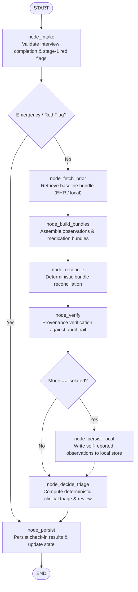

# LangGraph Check-in Completion Orchestrator

## Overview

ChronicCare AI processes patient check-in completions through an equivalence-proven pipeline. The check-in completion flow can run in two modes controlled by the `ORCHESTRATOR` environment variable:
1. `direct` (default): sequential in-process Python step functions.
2. `graph`: compiled LangGraph `StateGraph(CheckinState)` executing identical step functions with strict trace auditing.

Both modes are 100% equivalent in clinical triage decisions, database persistence, and API response schemas.

---

## Architectural Invariants

1. **Deterministic Execution**: The LangGraph orchestrator uses pure state transitions in Python memory. It requires **no checkpointer**, **no database network calls during graph routing**, and **no LLM invocations**.
2. **Single Compilation**: The graph is constructed and compiled once at module import (`orchestrator.graph.checkin_graph = builder.compile()`).
3. **Privacy Invariant (U6-04)**: Node trace entries capture only step names, start timestamps, execution duration in milliseconds, and aggregate counts/levels (e.g. `"3 observations compared, 1 conflict"`, `"level=urgent, requires_review=True"`). Trace records **never** contain patient names, dates of birth, or clinical reading values.
4. **Clinical Safety Priority**: "The model proposes, the rules decide." The orchestrator never lowers a triage level and adheres to deterministic clinical protocols.

---

## State Schema (`CheckinState`)

```python
class CheckinState(TypedDict, total=False):
    checkin: Dict[str, Any]
    user: Dict[str, Any]
    mode: str  # "connected" | "isolated"
    bundles: Dict[str, Any]
    recon_result: Optional[Any]
    verif_result: Optional[Any]
    triage: Optional[Dict[str, Any]]
    result: Optional[Any]
    emergency: bool
    trace: List[Dict[str, Any]]
    errors: List[str]
    record_label: Optional[str]
    parsed_context: Optional[Dict[str, Any]]
    triage_decision: Optional[Dict[str, Any]]
```

---

## Orchestrator Graph Architecture



---

## Node List

| Node Name | Function | Responsibilities | Trace Summary Pattern |
|---|---|---|---|
| `node_intake` | `step_parse_and_validate_intake` | Validates interview completion across v2/v3 engines; detects stage-1 clinical red flags | `intake validated; {N} intakes, emergency={bool}` |
| `node_fetch_prior` | `step_fetch_prior_bundle` | Fetches historical patient baseline from FHIR EHR (`connected`) or local SQLite (`isolated`) | `prior bundle fetched; {N} obs, {N} meds` |
| `node_build_bundles` | `step_build_bundles` | Converts completed interview state and medication confirmation items into FHIR bundles | `bundles built; {N} obs, {N} meds` |
| `node_reconcile` | `step_reconcile` | Executes deterministic M3 bundle reconciliation (`reconcile_bundles`) | `reconciled; {N} obs compared, {N} meds compared, {N} conflicts` |
| `node_verify` | `step_verify` | Executes deterministic M4 provenance verification (`verify_reconciliation`) | `verified; requires_review={N}, conflicts={N}` |
| `node_persist_local` | `step_persist_local_observations` | Saves self-reported observations to local SQLite store (isolated mode only) | `local observations persisted; {N} obs` |
| `node_decide_triage` | `step_decide_triage` | Applies clinical triage rules, stroke extras, and review escalation | `triage decided; level={level}, requires_review={bool}` |
| `node_persist` | `step_persist_and_respond` | Persists `checkin_results` row, updates `checkin` state to complete, and generates API response | `persisted checkin result; level={level}, status=complete` |

---

## Configuration & Feature Flag

The orchestrator mode is controlled via environment variable:

```bash
# Default mode: direct in-process execution
ORCHESTRATOR=direct

# Graph mode: LangGraph StateGraph execution
ORCHESTRATOR=graph
```

The endpoint dynamically reads `os.environ.get("ORCHESTRATOR", "direct")` per request, allowing dynamic runtime selection in both production deployments and automated test suites.
