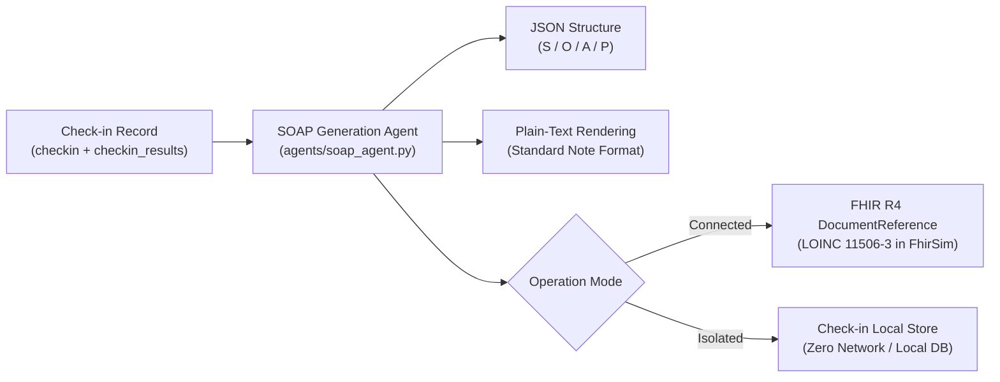

# SOAP Note Generation Agent (Agent 7)

> **Document Type**: Clinical Decision Support Specification & Traceability  
> **Proposal Alignment**: Section 13.1 (Agent 7), Section 35 ("Committed for Real Implementation")  
> **Status**: BUILT & VERIFIED (PR E, 9 November 2026)  
> **System Motto**: *"The model proposes, the rules decide."*

---

## 1. Overview & Architectural Role

The **SOAP Note Generation Agent** (`backend-poc-technical/agents/soap_agent.py`) synthesizes outputs from upstream agents (Agents 1–6) into a standardized Subjective, Objective, Assessment, and Plan (SOAP) clinical progress note for healthcare providers.



### Core Design Rules
1. **Deterministic, Zero LLM**: Built entirely from stored structured data in `checkins`, `checkin_results`, and `reading_history`. No LLM hallucination risk.
2. **Strict Invariant — No Invented Values (The HOTFIX 2 Principle)**: A clinical document read by a physician must never contain a number, finding, or reading that was not genuinely recorded in the stored check-in data. If a patient skipped a reading or answer, it is explicitly rendered as `"not answered"` or `"no reading today"`.
3. **Provider-Only Access**: Only users with authenticated `provider` or `admin` roles can retrieve SOAP notes (`GET /api/provider/review/{checkin_id}/soap`). Patient endpoints strictly omit SOAP summaries.
4. **No Guideline Text**: Due to copyright restrictions (ADA/AHA licences), guideline recommendations are cited strictly by **title and section path**, never by verbatim guideline body text.

---

## 2. Section Specifications & Source Field Mapping

Every line in the generated SOAP note maps directly to verifiable fields stored in the database:

| Section | Content Rendered | Source Fields in Database | Invariant / Boundary Rules |
|:---|:---|:---|:---|
| **Subjective (S)** | • General condition<br>• Reported symptoms<br>• Lifestyle / diet notes<br>• Danger words findings<br>• Medication adherence | • `checkin.state_json["answers"]`<br>• `checkin_results.intakes_json[]["symptoms"]`<br>• `checkin.state_json["wordgroup_hits"]`<br>• `checkin_results.triage_json["wordgroups"]`<br>• `checkin_results.intakes_json[]["adherence"]` | • Skipped answers mapped to `"not answered"`<br>• Empty answers never invent findings<br>• Danger words detected listed or `"None detected"` |
| **Objective (O)** | • Physiological readings (value, unit, source, trust level)<br>• Reconciliation discrepancies (connected mode)<br>• Longitudinal trend direction & sample size | • `checkin_results.intakes_json[]["readings"]`<br>• `checkin_results.reconciliation_json`<br>• `checkin_results.verification_json`<br>• Computed via `compute_trends(reading_history)` | • Trust: FHIR = `High`, OCR = `Medium`, Patient = `Low`<br>• If no readings: `"Readings: no reading today"`<br>• Connected mode lists observation/medication discrepancies |
| **Assessment (A)** | • Clinical triage level & color<br>• Deterministic rules rationale<br>• Stage-2 escalation (`raised_by`)<br>• Multi-model risk scores & top-3 drivers<br>• Investigational decision-support caveat<br>• Data confidence rating | • `checkin_results.triage_level`<br>• `checkin_results.triage_json["reasons"]`<br>• `checkin_results.triage_json["raised_by"]`<br>• `checkin_results.risk_json["models"]`<br>• `checkin.state_json["intake"]["confidence"]`<br>• `checkin.state_json["is_cold_start"]` | • Color mapping: routine = Green, review = Yellow, urgent = Red, emergency = Red (emergency)<br>• Cold start (first check-in) confidence capped at `Medium`<br>• Risk models include non-diagnostic caveat |
| **Plan (P)** | • Patient guidance already communicated<br>• Appointment action status<br>• Clinician review requirement<br>• Guideline evidence citations | • `checkin_results.triage_json["guidance"]`<br>• `checkin_results.explanation_json["sources"]` | • If triage level $\ge$ review: `"clinician review required"`<br>• Emergency notes immediate guidance given<br>• Appointment: `"appointment workflow: not available in this build"`<br>• Citations: title + section only (zero text) |

---

## 3. FHIR R4 DocumentReference Mapping (Connected Mode)

When a check-in is performed in **Connected Mode** (`mode == "connected"`), the agent generates a compliant FHIR R4 `DocumentReference` resource and persists it to the in-process FHIR simulator (`data_sources/fhir_sim.py`):

```json
{
  "resourceType": "DocumentReference",
  "id": "docref-{checkin_id}",
  "status": "current",
  "type": {
    "coding": [
      {
        "system": "http://loinc.org",
        "code": "11506-3",
        "display": "Progress note"
      }
    ],
    "text": "Progress note"
  },
  "subject": {
    "reference": "Patient/{record_patient_id}"
  },
  "date": "2026-11-09T04:00:00Z",
  "content": [
    {
      "attachment": {
        "contentType": "text/plain",
        "data": "<base64_encoded_plain_text>"
      }
    }
  ],
  "context": {
    "related": [
      {
        "reference": "Encounter/checkin-{checkin_id}"
      }
    ]
  }
}
```

- **In-Process FhirSim Storage**: The resource is retrievable via `GET /DocumentReference?patient={id}` or `GET /DocumentReference/{doc_id}` within the simulator.
- **Isolated Mode Parity**: In isolated local mode, the SOAP note is stored with the check-in locally in memory/app state, and zero calls or resources are dispatched to `FhirSim`.

---

## 4. API Endpoints & Access Control

### `GET /api/provider/review/{checkin_id}/soap`
- **Role Requirement**: `provider` (or `admin`). Enforced via `Depends(require_role("provider"))`.
- **Patient Access Defense**: Patients attempting to call this endpoint receive `HTTP 403 Forbidden` (`role_denied` audit event recorded).
- **Audit Logging**: Successful generation records one immutable row in `audit_log`:
  ```json
  {
    "action": "soap_generated",
    "target": "{checkin_id}",
    "outcome": "ok",
    "detail": {}
  }
  ```
  Strictly zero protected health information (PHI) is included in the audit row.

---

## 5. UI Integration

The provider review detail view (`app/components/provider/ReconciliationAlertDetail.tsx`) surfaces the SOAP note via a responsive, accessible accordion component:
- **Collapsible Layout**: Clickable header toggles the note visibility.
- **Copy Note**: One-click button copies `plain_text` directly to clipboard via `navigator.clipboard.writeText`.
- **Print Note**: Triggers native browser print dialog (`window.print()`) without adding heavy PDF dependencies.
- **Data Source Badges**: Displays provenance of all integrated clinical data sources (FHIR simulator, rules engine, predictive models, trend history).
