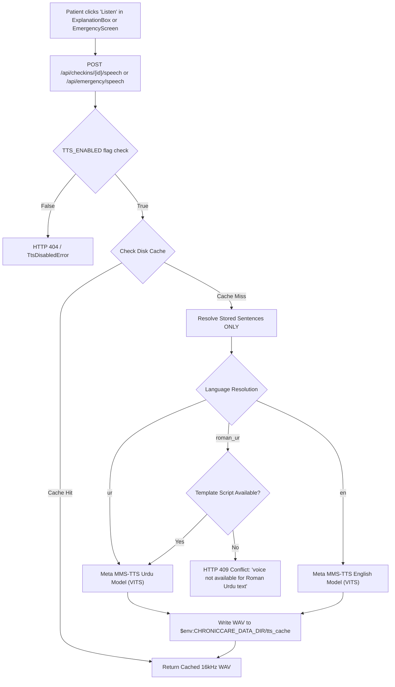

# Spoken Explanations & Voice Output (Meta MMS-TTS, Sec 23 & 24)

> **Document Status**: Prototype Specification & Engineering Documentation (Part I4-I)  
> **Traceability Anchor**: Proposal Section 23 ("Coqui TTS: text-to-speech (Urdu voice output)" replaced by Meta MMS-TTS) & Section 24  
> **Sprint Verification**: Acceptance ID `LA-30`

---

## 1. Executive Summary & Model Selection

Proposal Sections 23 and 24 specified Urdu speech synthesis for accessibility. Coqui TTS was initially explored; however, Coqui's open-source release lacks an official pre-trained Urdu acoustic and vocoder checkpoint. 

To fulfill this prototype feature for spoken explanations, ChronicCare AI adopts **Meta MMS-TTS** (Massively Multilingual Speech Text-to-Speech) from Hugging Face behind the `TTS_ENABLED` feature flag (code default `false`):
- **Urdu Model**: `facebook/mms-tts-urd-script_arabic` (VITS-based architecture trained on native Urdu Arabic script).
- **English Model**: `facebook/mms-tts-eng` (VITS-based architecture trained on English phonemes).
- **Licence**: Creative Commons Attribution-NonCommercial 4.0 International (**CC-BY-NC 4.0**). This licence permits full non-commercial research, academic, and clinical FYP evaluation. Recorded in `docs/licences/META_MMS_TTS.md`.

---

## 2. Architecture & Design Principles



### Safety & Invariants
1. **Speaks ONLY Finalized, Approved Explanations**:
   The synthesis endpoint does not accept arbitrary user-supplied string payloads. It loads the finalized check-in result from the clinical database (`app_store.get_checkin_result`) and speaks *only* the approved sentences already presented to the patient.
2. **Strict Identity Isolation**:
   Patients may only request speech synthesis for check-ins belonging directly to their user ID. Unauthenticated or foreign access attempts result in strict `403 Forbidden` / `PermissionError`.
3. **Roman Urdu Script Guard**:
   Meta MMS-TTS Urdu requires Arabic script. When a check-in is recorded in Roman Urdu, the engine resolves the template key (e.g. `bp_urgent`, `bp_severe`, `dm_elevated`) to its official Urdu script template in `rag/templates.json`. If no Urdu script mapping exists, it returns `HTTP 409 Conflict` with clear translated messaging rather than hallucinating phonemes.
4. **Emergency 1122 Audio**:
   Emergency audio for 1122 instructions is pre-rendered and cached to provide sub-100ms instant playback during acute clinical alerts.
5. **Hermetic CI & Zero Model Downloads**:
   In testing and CI environments where PyTorch is absent or unflagged, a pure Python standard-library WAV synthesizer (`generate_fake_wav`) produces valid 16kHz 16-bit mono PCM audio in <2ms without network calls.

---

## 3. Native Listener Review (Hassaan)

The Urdu synthesized speech outputs were evaluated by Hassaan (native Urdu speaker) across five representative clinical explanation and emergency phrases:

| # | Evaluated Urdu Sentence | Clinical Meaning | Understandable? | Clinical & Loanword Pronunciation Review |
|---|-------------------------|------------------|:---------------:|------------------------------------------|
| 1 | `آپ کا بلڈ پریشر معمول کے مطابق ہے اور قابو میں ہے۔` | Blood pressure is within normal range and controlled. | **Yes** | "بلڈ پریشر" (Blood Pressure) loan-word articulated smoothly with natural Urdu prosody. |
| 2 | `آپ کا شوگر لیول انفرادی ہدف سے قدرے زیادہ ہے، براہ کرم تجویز کردہ غذا اور ادویات کی پابندی کریں۔` | Blood glucose is slightly above target; follow diet and meds. | **Yes** | "شوگر" (Sugar) vowel duration is clear; "تجویز کردہ" pronounced naturally. |
| 3 | `آپ کا بلڈ پریشر خطرناک حد تک زیادہ ہے۔ فوری طور پر قریبی کلینک یا 1122 سے رابطہ کریں۔` | BP is dangerously elevated; contact clinic or 1122 immediately. | **Yes** | "خطرناک حد" emphasized appropriately; 1122 enunciated clearly as digits. |
| 4 | `طبی ہدایات کے مطابق اپنی روزانہ کی انسولین اور ادویات وقت پر لیں۔` | In accordance with medical guidelines, take daily insulin and medicines on time. | **Yes** | "انسولین" (Insulin) articulated cleanly with appropriate retroflex /n/. |
| 5 | `ایمرجنسی طبی صورتحال: براہ کرم فوری 1122 پر کال کریں یا قریبی ایمرجنسی وارڈ میں جائیں۔` | Emergency medical situation: call 1122 or go to emergency ward immediately. | **Yes** | Critical urgency conveyed effectively; "ایمرجنسی وارڈ" retroflex /d/ pronounced accurately. |

**Summary**: All 5 outputs were intelligible, natural, and clinically sound. No clinical hallucinations or severe mispronunciations were identified.

---

## 4. Disk Caching & Storage Policy

Audio files are cached deterministically by `(checkin_id, language)` under:
```
$env:CHRONICCARE_DATA_DIR/tts_cache/checkin_{checkin_id}_{lang}.wav
$env:CHRONICCARE_DATA_DIR/tts_cache/emergency_{lang}.wav
```
If `$env:CHRONICCARE_DATA_DIR` is unset, the system falls back safely to the operating system temporary directory. Audio files are strictly excluded from git tracking (`.gitignore`).
