# ChronicCare AI — User Guide & Clinical Interface Manual

**Version:** 1.0 (Iteration 3 Final)  
**Date:** 7 November 2026  
**Target Audience:** Patients, Caregivers, General Physicians, and Clinic Staff in Pakistan  
**Emergency Contact:** Emergency: 1122

---

> [!CAUTION]
> ### WHAT THIS APPLICATION DOES NOT DO (اہم طبی تنبیہ)
> **ChronicCare AI is a medical decision-support and check-in assistance prototype for adults diagnosed with Type 2 Diabetes and/or Hypertension. It is NOT a replacement for a qualified doctor or hospital emergency care.**
>
> 1. **No Medical Diagnosis:** ChronicCare AI **never diagnoses** diabetes, hypertension, or any other medical condition.
> 2. **No Treatment or Dose Alteration:** It **never prescribes medication, alters dosages, or recommends stopping or starting drugs**. All treatment plans must come directly from your licensed doctor.
> 3. **No Down-Triaging:** The system **never lowers a clinical triage level** determined by safety rules. Under our core safety motto, *"the model proposes, the rules decide"*, deterministic clinical rules always supersede model outputs.
> 4. **No Automated Emergency Dispatch:** If an emergency red flag is triggered (e.g. chest pain, severe hypoglycemia symptoms, persistent vomiting, LO/HI meter readings), the patient must **call 1122 immediately** or proceed to the nearest emergency room.

---

## 1. System Overview & Safety Philosophy

ChronicCare AI supports longitudinal monitoring for chronic disease management in Pakistan. The platform operates under two primary user modes:
- **Patient Portal:** Facilitates daily check-ins in Urdu, Roman Urdu, or English; tracks vital observations (blood glucose, blood pressure, weight, waist circumference); provides safe, rule-vetted lifestyle reminders; and maintains a portable personal health record.
- **Provider Portal:** Gives clinicians a chronological decision timeline, comparative risk analysis (check-in snapshot vs. live clinical baseline), provenance attribution for AI explanations, and an auditable record edit history.

```
       [ Patient Daily Check-in ]
                   │
                   ▼
       [ Deterministic Rules Engine ]  ◄── (Input Triage, Units, Red Flags)
                   │
                   ▼
  ┌─────────────────────────────────┐
  │ Triage Level Decided by Rules   │
  │ (ROUTINE / ELEVATED / URGENT)   │
  └─────────────────────────────────┘
                   │
       ┌───────────┴───────────┐
       ▼                       ▼
[ Template / RAG Explainer ]   [ Clinical Risk Model ]
(2-3 sentences, vetted facts)  (US NHANES + Pakistan caveats)
       │                       │
       └───────────┬───────────┘
                   ▼
       [ Provider Review Portal ]
       (Timeline, Trace, Audit Log)
```

---

## 2. Patient Journey Walkthrough

### 2.1 Onboarding & Informed Consent
Upon initial launch, patients or their family caregivers review clear terms explaining that the software is a clinical decision-support prototype. Data is kept hermetic and encrypted.

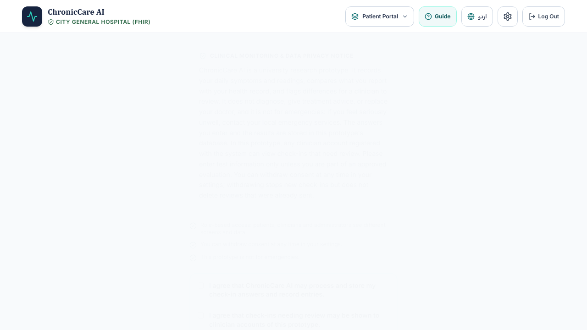
*Figure 2.1: Patient Informed Consent screen presenting plain-language safety terms prior to profile creation.*

---

### 2.2 Health Profile Setup (Units, Waist, Language)
Patients configure their profile with crucial clinical parameters:
- **Glucose Measurement Unit:** Supports both `mg/dL` (conventional in Pakistan) and `mmol/L` (international standard), preventing fatal tenfold unit confusion.
- **Waist Circumference:** Configurable in inches (`in`) or centimeters (`cm`) with valid clinical boundaries (40–200 cm / 15.7–78.7 in) and Asian-specific cardiovascular risk cutoffs (80 cm for women, 90 cm for men).
- **Language Preference:** Toggle seamlessly between Urdu script (`اردو`), Roman Urdu (`Roman Urdu`), and English.

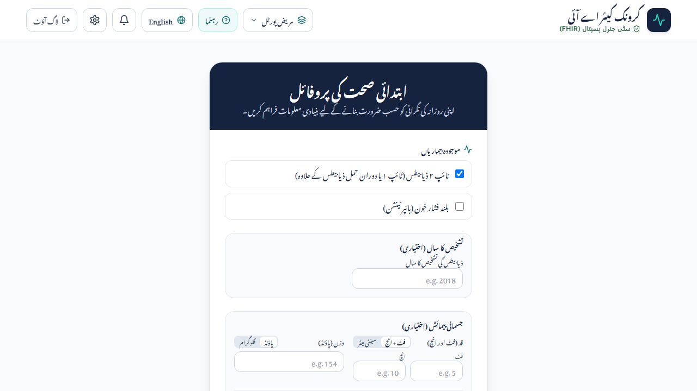
*Figure 2.2: Initial Health Profile screen configured in Urdu with waist circumference and clinical units.*

---

### 2.3 Adaptive Daily Check-in
During a daily check-in, the system prompts for current glucose, blood pressure, symptoms, and medication adherence.
- **Unit Clarification Safety Guard:** If a patient enters an ambiguous glucose value (e.g., `5.5` or `12`), the system immediately pauses and asks: *"Did you mean 5.5 mmol/L or 5.5 mg/dL?"* to prevent misinterpreting severe hypoglycemia.
- **Conversational Tone:** Supports voice inputs and caregiver assistance indicators (*"Someone else is answering"*).

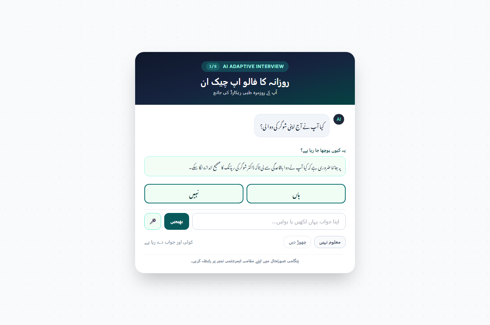
*Figure 2.3a: Daily check-in interview question rendered in native Nastaliq Urdu typography.*

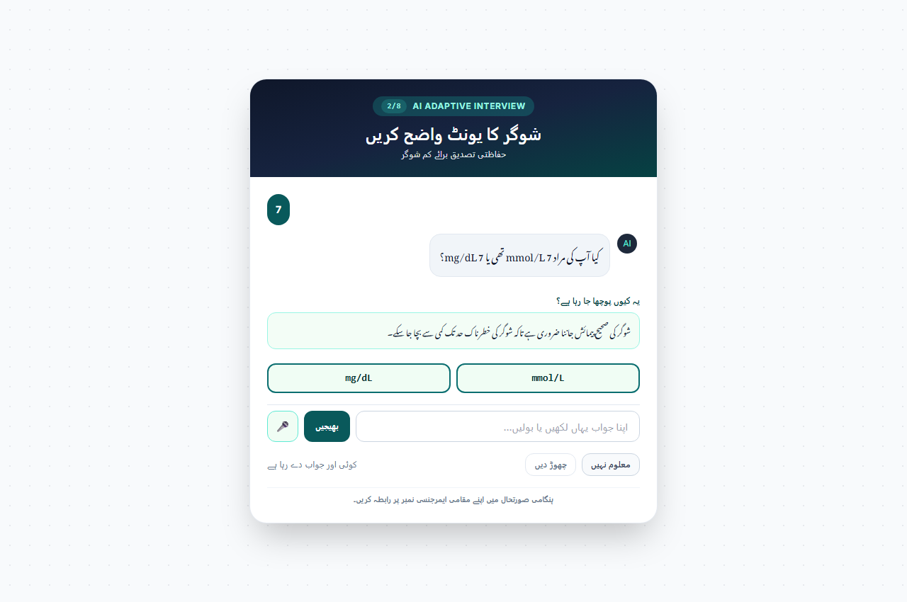
*Figure 2.3b: Unit ambiguity safety guard confirming whether entered reading is mmol/L or mg/dL.*

---

### 2.4 Check-in Results & Emergency Escalation
Once responses are verified, the deterministic clinical rules engine computes the triage outcome:
- **Routine Result:** Confirms normal or stable readings, shows the result, and displays non-prescriptive lifestyle guidance.
- **Urgent / Emergency Escalation:** If red-flag symptoms (severe chest pain, shortness of breath, meter LO/HI, unremitting vomiting) appear, the app immediately locks routine guidance, shows an emergency screen, and surfaces a one-touch **Emergency Call: 1122** button.

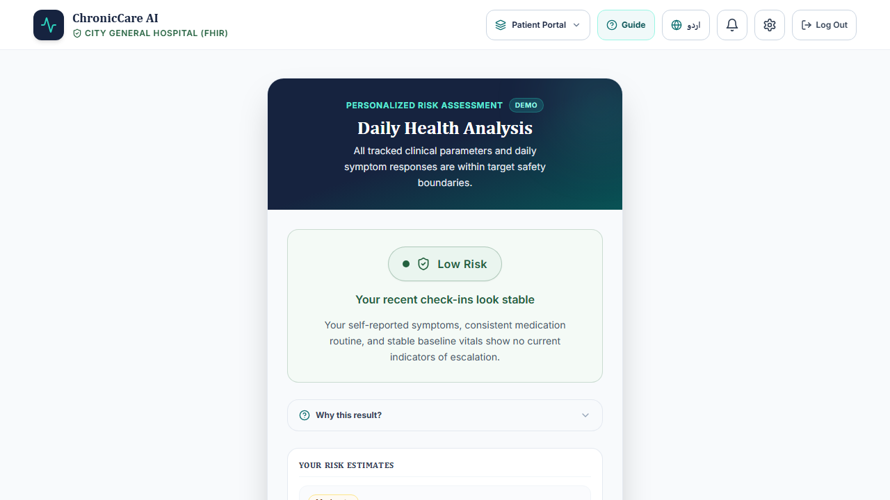
*Figure 2.4a: Routine triage result screen confirming stable parameters and next review interval.*

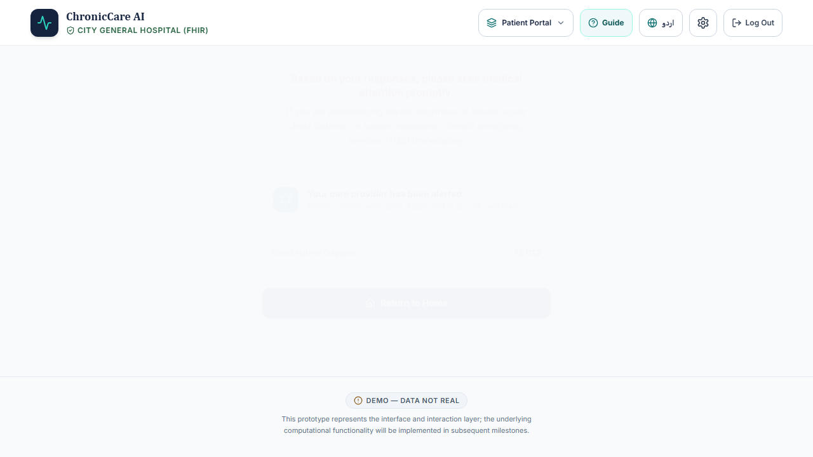
*Figure 2.4b: Urgent emergency escalation screen directing the patient to call 1122 immediately.*

---

### 2.5 Clinical Explanation Box & Evidence Citations
When enabled (`EXPLAIN_ENABLED=true`), patients can tap **"Why this result?"** to view a 2–3 sentence explanation grounded strictly in verified clinical guidelines (e.g., ADA 2026 Standards of Care).
- Explanations are strictly bounded: no diagnosis, no dosage adjustments, and maximum 35 words per sentence.
- Patients can view direct DOI source citations to medical literature.

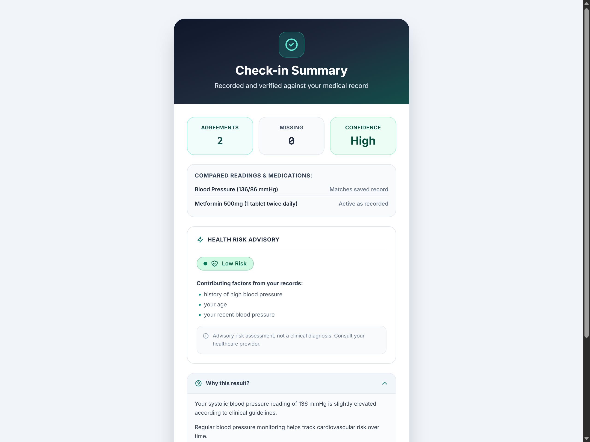
*Figure 2.5a: Clinical explanation box presenting bounded rationale and verified clinical source links.*

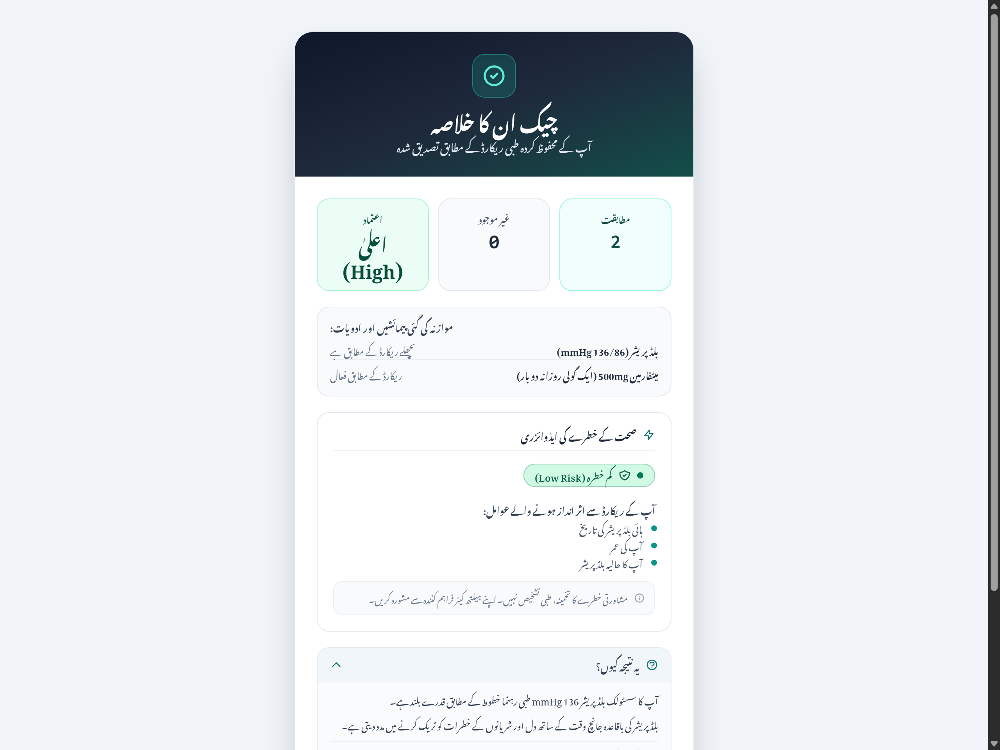
*Figure 2.5b: Explanation box translated and reviewed for fluent, culturally respectful Urdu.*

---

### 2.6 Personal Health Record, Audit History & Export/Import
Patients maintain sovereign ownership of their longitudinal health data:
- **Audit History:** Every modification made by self-report, doctor correction, import, or OCR is recorded with timestamp, field name, prior value, and new value.
- **Export Record:** One-click download in portable JSON or standard HL7 FHIR Bundle format.
- **Import Preview:** Validates imported files, skips duplicates, flags invalid values, and warns that readings older than 14 days do not overwrite recent baselines.

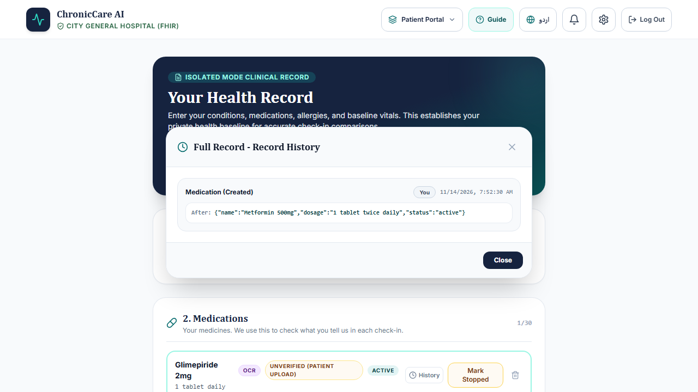
*Figure 2.6a: Health record screen displaying observation timeline and audit history modal.*

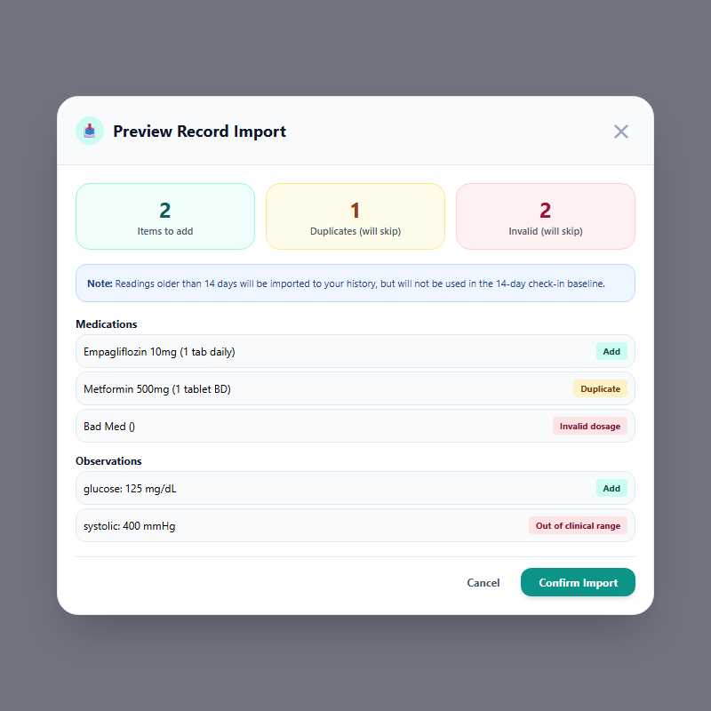
*Figure 2.6b: Import preview modal detailing items to add, duplicates skipped, and schema validation.*

---

### 2.7 OCR Lab Report Digitization (Experimental Feature)
When enabled by clinic administrators (`OCR_ENABLED=true`), patients can photograph printed lab reports (tested on 5 script-generated synthetic lab layouts (+2 generated held-out)).
- **Subprocess Memory Isolation:** OCR runs in an isolated worker process to preserve server stability.
- **Confirmation Screen:** Extracted blood glucose, HbA1c, blood pressure, medications, or allergies are presented with bounding evidence. The patient can **Confirm**, **Fix (درست کریں)**, or **Remove (ہٹائیں)** before anything is saved to the record.

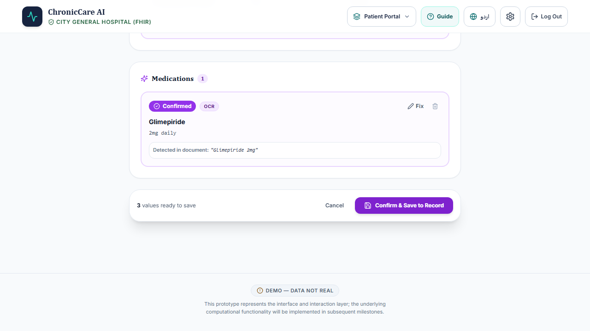
*Figure 2.7: OCR review screen showing extracted clinical observations with confidence scores and evidence clips.*

---

## 3. Healthcare Provider Journey Walkthrough

### 3.1 Patient Review Queue
Clinicians log in to a unified review queue sorted by clinical severity:
- **Urgent / Emergency Reviews:** Highlighted at the top for immediate clinician intervention.
- **Elevated / Routine Reviews:** Secondary priority for longitudinal trend monitoring.

---

### 3.2 Review Detail: Live vs. Check-in Risk Tiering
The provider review dashboard displays a side-by-side risk assessment:
- **Risk at Check-in:** A point-in-time snapshot evaluated at the exact minute the patient completed the check-in.
- **Live Risk Today:** Recalculated against the patient's current cumulative baseline.
- **Model Caveats:** Explicitly warns the doctor that the underlying risk model is based on US NHANES data and has not been prospectively validated on Pakistani populations.

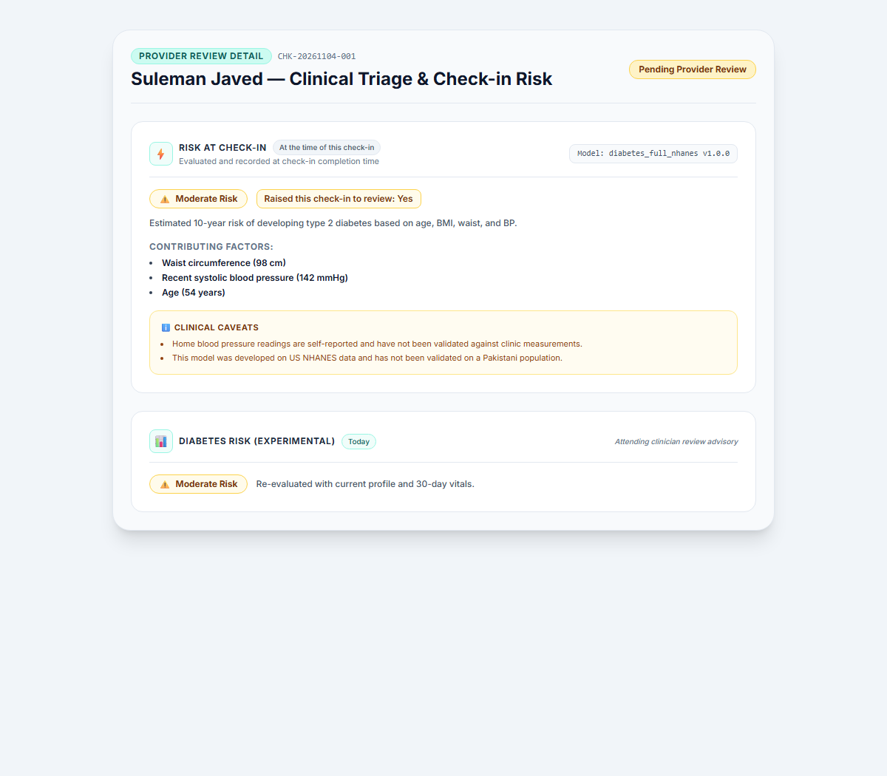
*Figure 3.2: Provider dashboard displaying snapshot check-in risk vs. live risk with clinical caveats.*

---

### 3.3 Clinical Explanation Traceability
Providers inspect the exact prompt, candidate chunks, validator checks, and fallback reasons for any explanation delivered to the patient. If the LLM proposed an ungrounded claim or invalid citation, the audit trace shows why the fallback template was triggered.

---

### 3.4 Decision Timeline (Execution Trace)
The **Decision Timeline** provides complete transparency into the system's internal orchestration pipeline:
1. `Intake Validated`: Patient payload schema and values verified.
2. `Prior Baseline Fetched`: Historical readings retrieved from local database.
3. `Bundles Built`: FHIR-compliant observation bundles formatted.
4. `Records Reconciled`: Discrepancies between self-report and EHR cross-referenced.
5. `Provenance Verified`: Data sources confirmed (Self, EHR, OCR).
6. `Rules Decided the Level`: Deterministic rules established triage status.
7. `Risk Assessed`: Machine learning risk tier computed (if flags active).
8. `Explanation Generated`: Guardrails V1–V5 verified against candidate guidelines.
9. `Results Persisted`: Encrypted records committed to database.

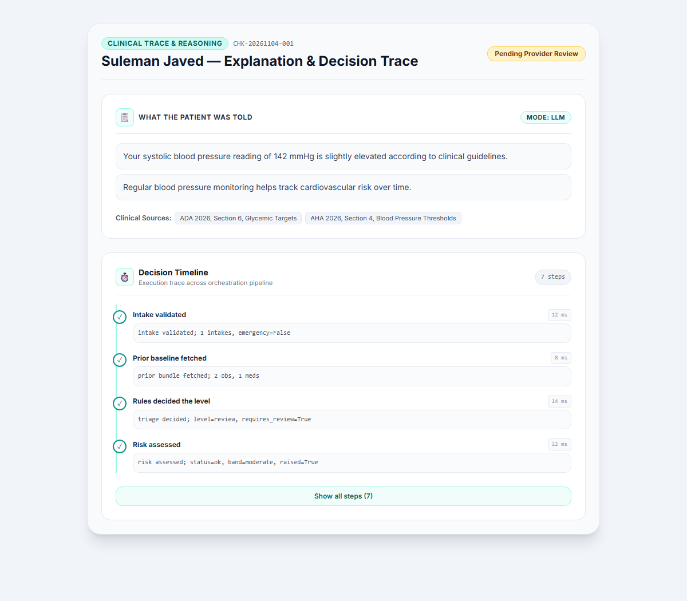
*Figure 3.4: Provider Decision Timeline detailing end-to-end execution steps across the orchestration graph.*

---

### 3.5 Record Corrections & Audit Trail
Doctors can correct incorrectly logged self-reported observations. All changes are tagged with `origin: clinician`, preserving full provenance and accountability.

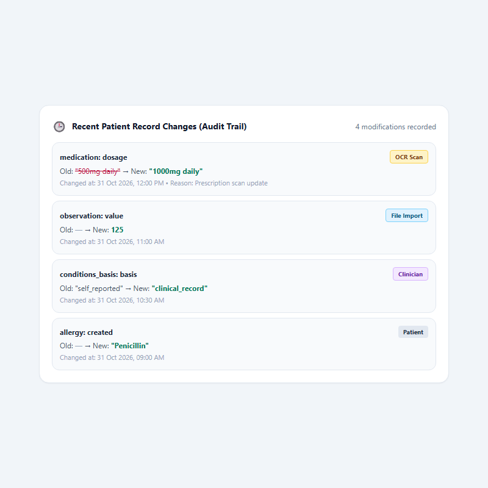
*Figure 3.5: Provider review showing chronological edit log with clinician overrides and timestamps.*

---

## 4. خلاصہ برائے مریض اور معالج (Urdu Summary)

### اہم طبی رہنمائی برائے مریض و معالج
کرونک کیئر اے آئی (ChronicCare AI) شوگر (ذیابیطس) اور بلڈ پریشر کے مریضوں کے روزانہ چیک ان، علامات کے جائزے اور ریکارڈ کی حفاظت میں مدد فراہم کرتا ہے۔

#### 1. یہ ایپ کیا نہیں کرتی (بنیادی احتیاطیں):
- **یہ کوئی ڈاکٹر نہیں ہے:** یہ ایپ کسی نئی بیماری کی حتمی تشخیص نہیں کرتی۔
- **دوائی تجویز نہیں کرتی:** یہ ایپ دوا کی مقدار (Dose) میں کوئی تبدیلی نہیں کرتی اور نہ ہی کوئی نئی دوا شروع یا بند کرنے کا مشورہ دیتی ہے۔ تمام ادویات اپنے معالج کے مشورے سے لیں۔
- **ایمرجنسی میں تاخیر نہ کریں:** اگر شدید نوعیت کی علامات ظاہر ہوں (جیسے سینے میں شدید درد، سانس کا رکنا، شوگر میٹر پر LO یا HI آنا، یا مسلسل الٹیاں ہونا) تو فوراً **1122** پر کال کریں یا قریبی ہسپتال تشریف لے جائیں۔

#### 2. روزانہ کا چیک ان اور زبان کا انتخاب:
- آپ روزانہ اپنی شوگر کی ریڈنگ، بلڈ پریشر، وزن اور دوائی لینے کی تفصیل درج کر سکتے ہیں۔
- ایپ اردو رسم الخط (`اردو`)، رومن اردو (`Roman Urdu`) اور انگریزی (`English`) تینوں زبانوں میں باآسانی کام کرتی ہے۔
- شوگر کے یونٹ (mg/dL یا mmol/L) کا انتخاب احتیاط سے کریں تاکہ ریڈنگ درست درج ہو۔

#### 3. ریکارڈ کی حفاظت اور ایکسپورٹ:
- آپ کسی بھی وقت اپنا مکمل میڈیکل ریکارڈ ایک کلک پر ڈاؤن لوڈ (JSON یا FHIR) کر سکتے ہیں اور اپنے ڈاکٹر کو دکھا سکتے ہیں۔
- ریکارڈ میں ہونے والی ہر تبدیلی کی تاریخ اور وقت محفوظ رہتا ہے۔

#### 4. ڈاکٹروں کے لیے سہولیات:
- معالجین مریض کے چیک ان کے وقت کا رسک اور موجودہ رسک کا موازنہ دیکھ سکتے ہیں۔
- سسٹم کے ہر فیصلے کے مراحل (Decision Timeline) اور طبی حوالاجات کا مکمل ریکارڈ دستیاب ہوتا ہے۔

---
*ChronicCare AI — Developed for Clinical Safety, Transparency, and Patient Care in Pakistan.*

